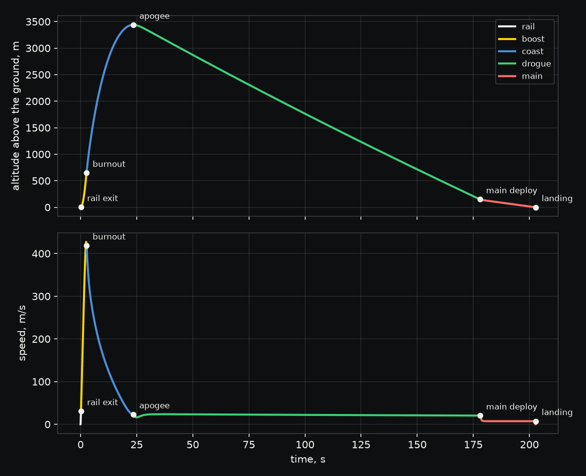

<p align="center">
  <a href="https://sohan-bhat.github.io/wobbl/">
    <picture>
      <source media="(prefers-color-scheme: dark)" srcset="site/assets/logo-dark.svg">
      
    </picture>
  </a>
</p>

<p align="center">
  <strong>Simulate anything before you build it.</strong><br>
  Verified strength, heat, circuit and motion simulation for coding agents and the people who design physical things.
</p>

<p align="center">
  <a href="https://github.com/sohan-bhat/wobbl/actions/workflows/ci.yml"></a>
  <a href="LICENSE"></a>
  <a href="pyproject.toml"></a>
</p>

<p align="center">
  <a href="https://sohan-bhat.github.io/wobbl/">Website</a> &nbsp;|&nbsp;
  <a href="https://sohan-bhat.github.io/wobbl/get-started/">Getting started</a> &nbsp;|&nbsp;
  <a href="https://sohan-bhat.github.io/wobbl/guides/">Guides</a> &nbsp;|&nbsp;
  <a href="https://sohan-bhat.github.io/wobbl/guides/cli/">CLI reference</a> &nbsp;|&nbsp;
  <a href="https://sohan-bhat.github.io/wobbl/examples/">Examples</a>
</p>


<p align="center"><sub>A real Wobbl output, a sand cast motor mount under a 2 kN belt pull, with the peak of 124 MPa at the rib tip and a safety factor of 1.33 against a target of 2.</sub></p>

## What it is

Wobbl is a command line tool, an MCP server and an agent skill that run real
engineering solvers and check every answer before anyone acts on it. Point it at
a STEP, IGES, STL or parametric Python part, ask a question in plain words or
with explicit loads and supports, and you get back the number, where it happens,
a confidence level with its reasons, the assumptions, a heatmap with the failure
point marked and fixes with numbers.

- Strength with [CalculiX](http://www.calculix.de), on second order tetrahedral
  meshes from [gmsh](https://gmsh.info) and OpenCASCADE that are refined around the
  peaks until the stress settles.
- Heat, steady and transient, also with CalculiX.
- Buckling, vibration and fatigue, also with CalculiX, for struts that buckle, arms
  and brackets that ring at a motor's speed or on a shaker, and how many load cycles
  a part lasts.
- Circuits with [ngspice](https://ngspice.sourceforge.io), for LEDs, RC networks,
  buck converters, MOSFETs or any netlist.
- Motion with [scipy](https://scipy.org)'s ODE integrators, from a rock falling off
  a cliff to a high power rocket on its thrust curve, through the standard
  atmosphere, wind and dual deploy parachutes.
- Combustion with [Cantera](https://cantera.org) on NASA's thermodynamic data, for
  flame temperatures and CEA style propellant performance, and solid rocket motors
  from their grains, propellant and nozzle to a thrust curve, with the casing
  checked against the peak chamber pressure.
- Mechanisms with [MuJoCo](https://mujoco.org), for any URDF, MJCF or spec: whether its
  motors hold and move it, how far it reaches, what collides, what tips and what each
  foot carries, plus ready made arms, linkages, gear trains and impacts.

`wobbl fix --apply` edits the part, adding fillets and gussets to any STEP file,
and runs the whole study again. The same tools work from your terminal and from
Claude Code, Codex, Cursor and Gemini CLI.

## Quick start

Wobbl needs Python 3.10 or newer and installs from PyPI.

```sh
pipx install wobbl
# or: uv tool install wobbl

wobbl setup     # solvers into ~/.wobbl, MCP server and skill for your agents
wobbl doctor    # check every piece
```

`wobbl setup` downloads a pinned micromamba and installs the solvers from
conda-forge into `~/.wobbl` (about 70 MB, no admin rights). Use
`wobbl setup --no-agents` for solvers only, or `--agents claude,cursor` to pick.

This first answer needs no files.

```sh
wobbl "will a blue LED on 5V with a 47 ohm resistor fry?"
```

Then try your own part.

```sh
# holes, fillets, sharp corners and face ids
wobbl inspect part.step

# ask in plain words, or give the material, supports and loads yourself
wobbl part.step "will this 6061 bracket yield under 50 lbf at the tip?"
wobbl run part.step -m petg --fix "bolt holes d=5.5" \
  --load "250 N down at 0,-15,31 @ holes d=3.4 rigid"

# build the fixes (fillets, gussets, thicker walls) and run each again
wobbl fix wobbl-out/part --apply
```

Or run a bundled example, which takes a few minutes.

```sh
git clone https://github.com/sohan-bhat/wobbl
cd wobbl/examples/shelf-bracket && ./run.sh
```

| Platform | CalculiX | ngspice |
|---|---|---|
| macOS Apple Silicon | native | Intel build under Rosetta 2 |
| macOS Intel | native | native |
| Linux x86_64 | native | native |
| Linux arm64 | native | not packaged, so install it with your package manager and Wobbl finds it |
| Windows x64 | native | native |

## Example output

This is a printed PLA shelf bracket, screwed to a wall and carrying its share of
an 8 kg shelf. Every run writes `summary.txt`, which is what an agent reads, along
with `report.html`, `outcome.json`, heatmaps and `result.vtu` for ParaView.

```console
$ cd examples/shelf-bracket
$ wobbl run bracket.py -m pla --fix "bolt holes d=4.5" --fix "wall x=min" \
    --load "40 N down @ top and within 12 of 65,12.5,6" -o output
$ cat output/summary.txt
FAILS. Peak 52.3 MPa on the 0.5 mm inside fillet (face 3) at (6.19, 12.6, 6.11). The part cracks at about 0.96x this load.

Confidence: high. passed mesh convergence, force balance, hand calculation, singularities, bolt bearing, units and sanity
Max deflection 3.47 mm at (90, 0, 6).

Checks:
  [pass] mesh convergence: max principal stress settled: 43 -> 50.9 -> 53 -> 52.3 MPa over 4 meshes, last change 1.4%
  [pass] force balance: reactions balance the loads to 0.00014% (forces) and 8.4e-06% (moments)
  [pass] hand calculation: beam theory through the critical section gives 15.2 MPa nominal; FEA peak is 3.45x that, a stress concentration of about 3.4 from the local shape
  [pass] singularities: no sharp corner or support artifact is above the reported stress
  [pass] bolt bearing: worst hole of fix1 (d 4.5 mm) carries 2.7 N sideways and 45.7 N along its axis; bearing stress 0.1 MPa, safety factor 499.33 on bearing
  [pass] units and sanity: part 123 mm across, peak strain 0.015, max deflection 3.47 mm (2.8% of size): all plausible

Suggested fixes:
  - Stress piles up in the 0.5 mm fillet. A fillet of 3 mm (about half the 6 mm wall) spreads it out. ...
  - The peak sits where two walls meet and bend. A gusset as thick as the wall ...
```

`wobbl fix output --apply` then builds each fix and solves it again.

| Version | Peak stress | Safety factor (PLA, 50 MPa) | Verdict |
|---|---|---|---|
| As drawn, 0.5 mm corner | 52.3 MPa | 0.96 | fails |
| 3 mm fillet | 24.1 MPa | 2.08 | marginal (target 2.5) |
| Legs thickened to 10 mm | 21.0 MPa | 2.38 | marginal |
| Gusset across the corner | 9.82 MPa | 5.09 | holds |

<p>
  
  
</p>

## Motion

Motion flies a body from release or ignition to the ground with scipy's DOP853
integrator, through gravity that falls off with altitude, the 1976 standard
atmosphere, drag that can change with Mach number, wind, a launch rail, a thrust
curve and drogue and main parachutes. The simplest run is a rock dropped off a
cliff, and it takes one line.

```console
$ wobbl motion --name rock --diameter "9 cm" --density "2700 kg/m3" --cd 0.6 --height "300 m"
OK. Hits the ground 8.72 s after release at 56.8 m/s (205 km/h). Without air it would land after 7.82 s at 76.7 m/s, so drag takes 26% off the impact speed.
```

A rocket is a TOML file with its motor's thrust curve, nose, fins, balance point,
rail and parachutes, where every quantity carries its unit. Wobbl adds Barrowman's
stability margin, the speed off the rail, peak dynamic pressure and acceleration,
apogee against a target, landing speed and drift, and when one falls short it gives
the nose weight, fin span, rail length or main parachute that would pass.

```console
$ wobbl motion examples/rocket-launch/rocket.toml
OK. Reaches 3439 m (11284 ft) at Mach 1.27 and lands 29.3 m upwind of the pad at 5.72 m/s, with a 1.88 caliber margin and 30.6 m/s off the rail.
```

| Run | Answer | Checked against |
|---|---|---|
| [Falling rock](examples/falling-rock) | 8.72 s and 56.8 m/s, against 7.82 s and 76.7 m/s without air | the tanh drag solution, sqrt(2h/g) without air and an energy balance |
| [Rocket launch](examples/rocket-launch) | 3439 m at Mach 1.27 with a 1.88 caliber margin, landing at 5.72 m/s | Tsiolkovsky's delta v less its losses, each parachute's terminal speed and an energy balance |



Every flight is integrated again with a tolerance ten times tighter, and each run
writes `trajectory.csv` with a row at every event. The body is a point mass in a
vertical plane, and a rocket turns into the wind it feels at its weathercock
frequency, which is the depth flights are usually planned at rather than a six
degree of freedom simulation. Motion needs nothing beyond scipy, so it downloads
nothing.

## Rocket motors and combustion

`wobbl motor` takes a solid motor design, its propellant, its grains from the
forward end, its nozzle and its casing, and burns it back to a thrust curve. It
knows BATES segments, tubes, end burners and star, finocyl, moon and X cores, and
KNSB, KNDX and KNSU with Nakka's burn rate laws and two MIT APCP propellants, or
your own burn rate and combustion data. The design is a TOML file, as in
[`examples/knsb-motor/motor.toml`](examples/knsb-motor/motor.toml), or a line of flags.

```console
$ wobbl motor examples/knsb-motor/motor.toml
MARGINAL. Peak chamber pressure 4.14 MPa against a casing that yields at 16.8 MPa, a safety factor of 4.07 (target 2). J602 motor, 1238 N s over 2.06 s at 120 s Isp.
```

The run integrates chamber pressure, mass flow and thrust from ignition through
tail off, and checks itself by halving the time step, closing the mass balance,
landing on the closed form pressure (a rho c* Kn)^(1/(1-n)) at the peak and, with
Cantera, recomputing the propellant's c* from equilibrium. The verdict comes from
the casing's hoop stress at peak pressure by Lame's solution, with the thin wall
hand calculation and Barlow's burst pressure beside it, the port to throat ratio
and core mass flux that drive erosive burning, and nozzle separation. Each fix,
a wider throat, a thicker wall, a segment fewer, wider cores or a smaller exit, is
simulated before it is suggested. The run writes `thrust.csv` and a RASP
`motor.eng`, and a rocket spec for `wobbl motion` can fly the design directly
with `design = "motor.toml"` under `[motor]`.

`wobbl flame` finds a fuel's adiabatic flame temperature and equilibrium products
in air or oxygen, checked against GRI-Mech 3.0's own data, the temperature with no
dissociation and the flammability limits, and finds the leaner mixture that keeps
a flame under a limit. `wobbl propellant` gives c* and Isp for shifting and frozen
expansion the way NASA's CEA does, for a preset or a composition such as
`ap:70,al:16,htpb:14`.

```console
$ wobbl flame propane --phi 1
OK. Adiabatic flame temperature 2266 K (1992 C) for propane in air at an equivalence ratio of 1, with 1.25% CO and 0.234% NO at equilibrium.
```

| Run | Answer | Checked against |
|---|---|---|
| [KNSB motor](examples/knsb-motor) | J602 peaking at 4.14 MPa, a casing safety factor of 4.07, ports too narrow at 1.59 times the throat | the closed form pressure, the mass balance, half the time step and Cantera's c* for KNSB |
| [Propane flame](examples/propane-flame) | 2266 K with 1.25% CO and 0.234% NO | GRI-Mech 3.0's data, the 2392 K no dissociation bound and the flammability limits |

Agents get `solve_motor`, `solve_flame` and `solve_propellant`. Cantera installs
itself the first time a combustion or motor study runs, a 6 MB download that takes
about 16 MB once Wobbl prunes what it never reads, or straight away with
`wobbl setup --only cantera`. The burning in a motor comes from the propellant's
burn rate law rather than resolved flame chemistry, and erosive burning, ignition
delay and throat erosion are flagged rather than modeled. Wobbl models given
designs only and gives no guidance on making or handling propellants.

`wobbl runaway` asks whether a lithium ion cell can run away on its own. A charged
cell's SEI, electrodes and electrolyte decompose at Arrhenius rates, and Wobbl
finds the surrounding temperature at which that heat outruns the cell's
convection and radiation, by Semenov's criterion and by a transient with the
reactants used up, then gives the margin and the cooling that would restore it.
It can take its surroundings from a finished heat study, so the
[cell runaway](examples/cell-runaway) example reads the 74.5 C hottest point of the
battery pack example and finds runaway would need 155 C. The kinetics are
Hatchard's for a fully charged LiCoO2 18650, which Wobbl places within a kelvin
of the published 155 C oven onset, so for other chemistries the answer is
indicative, and agents get the same as `solve_runaway`.

## Mechanisms

`wobbl simulate` takes any URDF or MJCF model, a TOML spec of bodies, joints, drives
and a move, or a mechanism described in words, and runs it in
[MuJoCo](https://mujoco.org) with each drive held to its torque and speed limit. The
question picks the physics: torque (whether the motors hold and move it), kinematics
(reach and range), collision (parts running into each other or the floor), stability
(tipping), contact (what each foot or wheel carries) and dynamics (the model run as
written). A question that names none gets torque, reach and collisions for a fixed
base, or contact, stability and stance torque for a robot that stands.

```console
$ wobbl simulate kuka_iiwa/model.urdf "can it hold a 5 kg payload anywhere in its range?"
torque      MARGINAL  Every joint holds the mechanism with 5000 g at the lbr_iiwa_link_7, but moving at full speed the lbr_iiwa_joint_2 needs 300% of what its drive gives at that speed.
kinematics  OK        The lbr_iiwa_link_7 reaches up to 1326 mm from the base, 957 mm out sideways and from -318 to 1316 mm in height.
```

Each analysis searches the whole joint range for its worst pose, closing any loops by
Newton steps, and checks itself: a second search from another start, a moment sum
over every body a joint carries, the straight line through the joints that bounds
reach, a second set of random poses for collisions, the floor's push against the
weight once a robot settles, and the linearized balance against the run for a model
left to itself. Every fix is solved again before it is suggested. Model files are
read the way people share them. Meshes behind `package://` paths are found, meshes
MuJoCo cannot read are dropped with their mass kept, a link with no mass takes it
from its shape, a home keyframe is the starting pose, and every such guess is written
into the report. A CAD assembly runs from a short spec that names each part's solid in
a STEP file (`cad = "arm.step"` and a `[[part]]` table per part) and where its joint
sits in the assembly's own coordinates, with each part's mass worked out from its
volume and material.

To show this works on models nobody tuned for, 27 public ones run in
`tests/test_mechanism_zoo.py` with `WOBBL_ZOO=1`, each asked a plain question: from
MuJoCo Menagerie the SO-101, Dynamixel 2R, Unitree Go1, UR5e and Franka Panda, MuJoCo's
car, slider crank and tendon arm, DeepMind Control's acrobot, finger, manipulator,
walker and quadruped, Gymnasium's ant, humanoid, pusher, double pendulum and half
cheetah, PyBullet's KUKA iiwa, xArm 6, R2-D2, Husky, two joint robot and cartpole, the
ROS URDF tutorials and Drake's acrobot. All 27 run and pass their own checks.

A mechanism described in words runs a ready made study, which goes deeper on one
question. A desktop arm on hobby servos gets inverse dynamics along a pick and place,
judged against each servo's line for a stall and its RMS for heat, as in
`wobbl simulate "can two mg996r servos lift 500 g with a robot arm?"`. A four bar gets
its swing, toggle positions and transmission angle, a gear train its output speed with
mesh losses, an impact its peak force and a stand its tipping point.

| Run | Answer | Checked against |
|---|---|---|
| [Desktop arm](examples/desktop-arm) | the shoulder stalls lifting 500 g, needing 1.35 N m where its MG996R gives 1.07 N m | the moments of the weights about each joint, a run with the servos' limits, half the time step and an energy account |
| [Wiper linkage](examples/wiper-linkage) | sweeps 94.3 degrees with a 45 rpm motor peaking at 5.41 N m, but its transmission angle falls to 35.5 degrees | Freudenstein's equation at every crank angle, virtual work, half the time step and an energy account |


Every run writes `trajectory.csv` and `playback.json`, which holds the bodies as
simple shapes with their poses through the run and each joint's torque beside its
motor's limit. When an answer comes from searching poses rather than one run, a short
run drives the mechanism through the worst poses found with its real limits, so the
playback shows them. Bodies are rigid and contacts are stiff springs whose depth is
checked. An impact's bounce does not depend on that stiffness but its peak force
does, so Wobbl tunes the contact to Hertz theory for the two materials and reports the
force at medium confidence. MuJoCo installs itself the first time a mechanism runs, a
7.8 MB download that takes 18.3 MB once Wobbl leaves out its headers, plugins, viewer
and renderers, or straight away with `wobbl setup --only mujoco`.

## Buckling, vibration and fatigue

The same meshes answer how a part lasts, not only whether it holds once.
`wobbl buckling` finds the factor on the loads at which the part buckles with
CalculiX's buckling step, then cuts it by an imperfection knockdown for the shape
and by yielding. Struts follow the European column curves, thin cylinders NASA
SP-8007 and flat plates keep their factor, while shapes with no published test data
take 0.5 and say so. Linear buckling overpredicts the collapse of real parts, most
of all thin shells, so the verdict always uses the knocked down factor.

```console
$ wobbl buckling examples/strut-buckling/strut.py -m 6061-t6 --fix "z=min" \
    --fix "fixed-xy z=max" --load "7 kN -z @ z=max" --target-sf 3
MARGINAL. Buckles at 3.25 times the applied load (22764 N) in a column mode. With a knockdown of 0.81 for imperfections and yielding the design factor is 2.65 against a target of 3.
```

`wobbl vibration` finds the natural frequencies and mode shapes of the part as it
is held, with each motor, battery or payload given as a mass, and judges them
against a rotor's once per turn and blade pass bands or any other tone, keeping
every mode that moves mass 20% clear. A shaker sweep gives the peak stress, which
Wobbl sums over the modes and CalculiX solves again with its steady state dynamics
step reading the same modes. The part's own loads, such as an unbalanced motor on
its pad, sweep the same way as harmonic forces when only a band is given. A random
input such as NASA GEVS gives the 3 sigma stress by Segalman's method and
Steinberg's fatigue estimate over the test. Every answer checks the meshes, the mass
against the volume and density, Rayleigh's quotient from the sag under 1 g and a
single mode estimate, Miles' equation for random input.

`wobbl fatigue` turns a finished strength or vibration result, a part and its loads
(solved first), or stresses you give, into the cycles before a crack starts and a
safety factor on stress. The load can cycle at one ratio, through blocks of a duty
cycle or through a measured load history counted by rainflow. It uses sourced S-N
data for each library material, Marin factors for surface, size, load and
reliability, Peterson's notch sensitivity on the stress concentration the strength
result found, Goodman, Gerber or Soderberg for the mean stress and Miner's rule.

All three take any part with any supports and loads, walls included, the way a
strength study does, and run through `wobbl simulate` as well as their own commands.

| Run | Answer | Checked against |
|---|---|---|
| [Drone arm resonance](examples/drone-arm-resonance) | modes at 197 and 219 Hz sit inside the propeller's once per turn and blade pass bands, so it fails | Rayleigh's quotient within 0.1% of the first mode, the mass to 0.0003% and two meshes 1.2% apart |
| [Strut buckling](examples/strut-buckling) | buckles at 3.25 times 7 kN, a design factor of 2.65 against 3 after the column curve | Euler's column within 0.5% |
| [Motor mount fatigue](examples/motor-mount-fatigue) | ten years of starts and running use 63% of the fatigue life, a factor of 1.03 on stress | the same verdict under Goodman, Gerber and Soderberg |

Agents get `solve_buckling`, `solve_vibration` and `fatigue_life`, which download
nothing because they run on the CalculiX that strength already installs. CalculiX
has no random response step, so Wobbl sums random response from its modes. Damping
is one ratio for every mode, 2% for metals and 3% for plastics unless you give one,
and the response at a resonance scales with one over it. Fatigue lives scatter by a
factor of three to ten at the same stress, so the safety factor on stress is the
number to lead with, and crack growth after a crack starts is a separate study.

## Crack growth

Crack growth follows a fatigue crack through any part from the place it starts to the place it
fails the part. Ask it in words, or start from a finished strength or fatigue result, which brings
its part, loads, supports and governing point, and from a fatigue result its duty cycle and
required life.

```console
$ wobbl simulate bracket.py "how long until a crack from the pin hole grows critical?" -m 7075-t6 \
    --fix "bolt holes d=6.6" --load "4 kN 0.866,0.5,0 bearing @ hole d=8" --target-life 100000
```

Unless a crack is given, it starts as the flaw damage tolerance practice assumes (MIL-A-83444 and
JSSG-2006) at the most stressed point: a corner crack at a hole, a semicircular surface crack
elsewhere, or a crack through a thin wall. The crack is cut into the CAD and meshed with a fine
tube of quarter point elements along its front. K_I, K_II and K_III come from the opening of the
crack faces, and every front point turns by the maximum tangential stress angle and moves at its
own growth rate, with a new mesh each step, so the path comes from the geometry rather than from
an assumption. Growth follows the NASGRO equation with sourced constants for 7075-T6, the common
aluminum alloys and three classes of steel, other metals get BS 7910's steel law scaled by their
stiffness and flagged as estimated, and loads cycle at an R ratio, as a file of cycles or as
blocks such as `100% x 3650 R=0`.

The K found along the path drives a Monte Carlo over 20,000 parts with scattered starting
flaws, growth constants, loads and toughness. The answer is the spread of lives, B50, B10 and B1,
the share failing before the target and an inspection interval, because no model can say when one
particular part will fail.

| Run | Answer | Checked against |
|---|---|---|
| [Bracket crack](examples/bracket-crack) | a crack at the pin hole cuts the lug after about 83,400 cycles, one bracket in a hundred by 36,600, so 71.5% fail before 100,000 | K on two front meshes 0.1% apart, a weight function within 8%, the force balance and the Monte Carlo's sampling band |

Each run writes `playback.json` with the part, every front and the spread of lives, which a
viewer plays back. Crack growth is linear elastic fracture mechanics, so crack tip plasticity,
crack faces pressing on each other and the environment are not modeled, and plastics need
measured growth constants.

## An agent on its own versus Wobbl

Given a CAD file, a strength question and 15 minutes, a capable coding agent
working alone answered in 1 of 10 trials across six
parts. Its hand calculations on beam like parts were good, within 1 to 5%. On the
ribbed cast motor mount and the thin walled enclosure, the two parts that
actually fail, it delivered nothing in six trials, because it kept writing its own
finite element code and hitting the same traps, such as meshers folding thin curved
walls, singular peaks at bonded bolts and load idealizations that flip the verdict.

Wobbl answers the same parts in minutes and handles each of those traps by default.

| Part | Converged reference | Wobbl | Confidence |
|---|---|---|---|
| Cast motor mount, belt pull through four bolts | 124.3 MPa at the rib tip | 123.7 MPa, same spot | medium, because the verdict flips if the servo is treated as rigid (55.0 versus 124 MPa), and Wobbl says so |
| ABS enclosure shell pressed near a corner | 93 MPa, 1.93 mm deflection | 93.0 MPa, 1.92 mm | medium, because large deflection theory lowers the peak 11%, and Wobbl says so |
| PA12 truss drone arm, thrust and torque | 11.5 MPa, 4.09 mm rise | 11.49 MPa, 4.08 mm | high |
| PLA bracket, sharp inside corner | about 78 MPa | 80.5 MPa | high |

The full comparison, with times and every trap, is [on the website](https://sohan-bhat.github.io/wobbl/validation/bakeoff/).

## Using it from agents

`wobbl setup` registers an MCP server and installs a skill for every coding
agent it finds, backing up each file it touches. `wobbl uninstall` removes
exactly what it added.

| Agent | MCP server | Skill or context |
|---|---|---|
| Claude Code | `claude mcp add --scope user wobbl` | `~/.claude/skills/wobbl/SKILL.md` |
| Codex | `[mcp_servers.wobbl]` in `~/.codex/config.toml` | `~/.codex/skills/wobbl/SKILL.md` |
| Cursor | `mcpServers.wobbl` in `~/.cursor/mcp.json` | `~/.cursor/skills/wobbl/SKILL.md` |
| Gemini CLI | extension at `~/.gemini/extensions/wobbl/` | `WOBBL.md` in the same extension |

The agent gets 27 tools, `inspect_geometry`, `mesh`, `new_study`,
`set_material`, `apply_load`, `add_fixture`, `solve_structural`, `verify`,
`render`, `suggest_fix`, `quantify_uncertainty`, `validate_against_tests`,
`assess_credibility`, `plan_tests`, `solve_thermal`, `solve_circuit`,
`solve_motion`, `solve_motor`, `solve_flame`, `solve_propellant`, `solve_flow`,
`solve_buckling`, `solve_vibration`, `fatigue_life`, `solve_plastic`,
`solve_mechanism` and `list_materials`.
Results are compact JSON with image and report paths. The skill teaches the
workflow and what never to skip, which means reading the checks before the number,
never quoting an excluded peak and making the supports match the real build.

```text
> Will this printed PLA shelf bracket hold its share of an 8 kg shelf?

agent: solve_structural(path="bracket.py", material="pla",
                        fixtures=["bolt holes d=4.5", "wall x=min"],
                        loads=["40 N down @ top and within 12 of 65,12.5,6"])
       verdict fails, 52.3 MPa on the 0.5 mm inside fillet, safety factor 0.96, confidence high
agent: suggest_fix(result_dir, apply=true)
       3 mm fillet 24.1 MPa (2.08), legs at 10 mm 21 MPa (2.38), gusset 9.82 MPa (5.09)
```

Strength studies take one to seven minutes on a 2018 laptop. Each agent's setup, the
timeouts and every tool are [on the website](https://sohan-bhat.github.io/wobbl/guides/agents/).

## What it checks

Every strength answer runs these checks and turns them into a confidence level,
high, medium or low, always with the reasons. A result that failed a check is
never reported as high confidence.

- Mesh convergence over at least three meshes, refined around the peaks that matter.
- Force and moment balance, with the reactions cancelling the loads to 0.5%.
- A hand calculation with beam theory through the critical section, and a check that the stress concentration is physical.
- Singularities, with sharp inside corners found from exact CAD normals and the peaks there and at idealized supports excluded, named and tracked.
- Load introduction, where off part loads are solved both rigid and distributed, each converged at its own peak, and the spread is reported.
- Bolt bearing at bolted holes, in place of the idealized peak.
- Units and sanity for the part size, peak strain and deflection.
- Large deflection, a nonlinear re-solve when the part bends a good fraction of its wall.

Heat answers check energy balance and a lumped hand calculation, and circuit
answers are compared with the textbook and run again at half the time step. Motion
answers are integrated again with a tolerance ten times tighter, compared with
closed forms wherever the model reduces to one and closed with an energy balance,
and a rocket's speed at burnout has to match Tsiolkovsky's delta v less what
gravity, drag and steering took. Every
study has a time budget, and when it runs out the last finished mesh level comes
back with its checks. The same input gives the same answer on every run, because
meshing, wall thickness sampling and the budget are all deterministic. The website
explains every [check](https://sohan-bhat.github.io/wobbl/guides/results/checks/) and how the
[confidence](https://sohan-bhat.github.io/wobbl/guides/results/confidence/) is set.

## How far a simulation can stand in for a test

Industry already lets simulation replace some physical tests when the model's
credibility is shown. Euro NCAP's virtual testing protocol accepts validated models
in place of part of its test matrix, and ASME V&V 10, V&V 20 and V&V 40 and the
NAFEMS guidance describe the evidence that takes. Wobbl produces that evidence for
any finished run and narrows the physical tests to the ones that matter. It does
not certify anything, and the reviewer decides what the evidence is enough for.

```sh
wobbl uncertainty wobbl-out/mount --vary "load lognormal 10%" --vary "yield 8%" --vary "E 3%"
wobbl validate-against wobbl-out/mount readings.csv
wobbl credibility wobbl-out/mount --influence high --consequence medium
```

- `wobbl uncertainty` works on a finished run of any domain. Any number the run
  was made from (a load, a dimension, a drag coefficient, a film coefficient, the
  air temperature) can scatter by its name in `request.json`, and the run is solved
  again through its own analysis at a design of values with Latin hypercube
  sampling on top. It returns the probability of failure against the run's own
  criteria with its 95% interval, the spread of the answer and Sobol indices that
  rank the inputs, with the leave one out error of the polynomial chaos fit. A
  strength run scales exactly with load, stiffness and strength instead, in seconds.
- `wobbl validate-against` reads a CSV of readings of any value the run reports
  (an apogee, a pressure drop, a peak temperature), a column of a time series it
  wrote at a stated time, or strain and dial gauges on a part, and computes the ASME V&V 20
  comparison error and validation uncertainty of each and the area metric, and
  calibrates the uncertain inputs with stated posterior intervals. For a strength
  run it also says which load attachment idealization the readings favour.
- `wobbl credibility` weighs code verification (the validation suite), solution
  verification (each run's own checks), validation, applicability and the answer's
  uncertainty against the model's influence and the decision's consequence, in the
  manner of V&V 40. It adds a credibility section to `report.html` and writes
  `credibility.html`, a self contained page an engineer can hand to a reviewer.
- `wobbl test-plan` recommends the smallest set of physical tests that most reduce
  the risk, with gauge positions, load steps and predicted readings, and says which
  usual tests the simulation evidence can likely stand in for and which it cannot.

On the [cast mount](examples/cast-mount-credibility) the chance of yielding under a
10% load scatter and an 8% yield scatter comes out about 1 in 77, the belt pull
explains 61% of the spread, and the plan asks for a gauged load test, one gauge
where the two servo idealizations disagree, a load cell in service and coupons.

## Validation

Fifty seven cases with known answers run through the same pipeline you get. Every
case passes its tolerance, and every case whose reference is exact for the
modeled setup lands within 2%.

| Group | Cases | Largest error |
|---|---|---|
| Textbook and benchmark strength (Timoshenko, Kirsch, Lame, NAFEMS LE1 and LE10, torsion, self weight, a cantilever on an elastic root) | 9 | 1.54%, plate with a hole |
| Real parts against converged reference models | 5 | 4.26%, PLA bracket with a 6 mm fillet |
| Heat (slab conduction, lumped cooling, a bar whose end jumps to 120 C) | 3 | 0.85%, the bar against the erfc solution |
| Circuits (LED, RC, buck ripple) | 3 | 7.70%, buck ripple against an ideal formula that ignores switch and diode drops |
| Motion (free fall, drag fall, a throw, a constant thrust rocket's burnout speed and altitude, parachute descent) | 6 | 0.0000014%, the rocket's burnout altitude |
| Combustion (methane flame against Turns, LOX and LH2 c* and Isp against NASA CEA, KNSU c* against PROPEP) | 4 | 0.05%, the LOX and LH2 c* |
| Solid motors (steady Kn against the closed form, a neutral grain's web time, two MIT static fires) | 4 | 9.26%, the impulse of the O3800 static fire, whose peak pressure came out 7% low |
| Battery (a charged LiCoO2 18650's runaway onset against Hu et al. and Hatchard's oven tests) | 1 | 0.62%, 155.96 C against 155 C |
| Uncertainty and calibration (a cantilever's mean and spread of deflection against lognormal propagation, Ishigami Sobol indices, two calibrations from synthetic data) | 5 | 0.97%, a film coefficient from a cooling curve |
| Mechanisms (a pendulum's large swing, a four bar's sweep, a two link arm's holding torque, a gear train's output speed, an elastic and a half elastic collision) | 6 | 0.05%, the struck ball's speed after the half elastic hit |
| Buckling, vibration and fatigue (Euler's column, a cantilever's first three bending frequencies, a simply supported plate's first three modes, a sine peak on a tip mass, a force swept through resonance, Shigley's fatigue example) | 6 | 2.28%, Shigley's example, where the book reads f off a chart |
| Crack growth (a center and an edge crack against Tada, a surface crack against Newman and Raju, Paris life against its closed form, the turn of a crack at 45 degrees) | 5 | 3.45%, the surface crack, where Newman and Raju's fit is good to 5% |

The full table is [on the website](https://sohan-bhat.github.io/wobbl/validation/). Run it yourself with
`wobbl validate`, which takes about 30 minutes.

## Examples

Each folder in [`examples/`](examples) is a real product with its real outputs, the
reports, heatmaps and summaries, and each has a page [on the website](https://sohan-bhat.github.io/wobbl/examples/).

| Example | Question | Domain |
|---|---|---|
| [cast-motor-mount](examples/cast-motor-mount) | Does a cast motor mount meet a safety factor of 2 under a 2 kN belt pull? | strength, remote loads |
| [cast-mount-credibility](examples/cast-mount-credibility) | How far can simulation stand in for testing that mount, and which tests does it still need? | uncertainty, tests, credibility |
| [shelf-bracket](examples/shelf-bracket) | Does a printed PLA bracket hold an 8 kg shelf, and what fixes it? | strength, fixes |
| [motor-mount](examples/motor-mount) | Do the ribs on a printed NEMA 17 mount earn their keep? | strength |
| [enclosure](examples/enclosure) | Does a PC enclosure survive a thumb press, and how far does it dent? | strength, thin walls |
| [drone-arm](examples/drone-arm) | Is a PA12 drone arm strong enough at full throttle? | strength, rigid loads |
| [drone-arm-resonance](examples/drone-arm-resonance) | Does that arm resonate with its propeller anywhere from hover to full throttle? | vibration |
| [strut-buckling](examples/strut-buckling) | Does a slender aluminum strut carry 7 kN with a factor of 3 against buckling? | buckling |
| [motor-mount-fatigue](examples/motor-mount-fatigue) | Does the cast motor mount last ten years of starts and running without a crack? | fatigue |
| [bracket-crack](examples/bracket-crack) | Where does a crack at a lug's pin hole go, and do 99% of brackets last 100,000 cycles? | crack growth |
| [heat-sink](examples/heat-sink) | Does a 15 W chip stay under 85 C without a fan? | heat |
| [battery-pack](examples/battery-pack) | When does a pack in a sealed box pass 60 C? | transient heat |
| [falling-rock](examples/falling-rock) | How fast does a rock hit the ground after a 300 m fall? | motion |
| [rocket-launch](examples/rocket-launch) | Will an L class rocket fly straight, reach 11,000 ft and land softly? | motion, rocketry |
| [knsb-motor](examples/knsb-motor) | Will a 54 mm KNSB motor hold its casing, and what thrust curve does it give? | solid motors |
| [propane-flame](examples/propane-flame) | How hot does a propane flame get, and how much CO and NO does it make? | combustion |
| [cell-runaway](examples/cell-runaway) | Can a cell at the hottest point of a sealed battery pack run away on its own? | battery, heat |
| [desktop-arm](examples/desktop-arm) | Can hobby servos lift 500 g through a desktop arm's pick and place? | mechanisms |
| [wiper-linkage](examples/wiper-linkage) | Does a wiper linkage sweep 95 degrees, and can its motor drive it over dry glass? | mechanisms |
| [circuits](examples/circuits) | Will this LED fry? What is the ripple? How hot is the MOSFET? | circuits |

Each folder has a `run.sh` that regenerates its outputs.

## Documentation

- [Getting started](https://sohan-bhat.github.io/wobbl/get-started/), to install, set up and run a first study
- [Guides](https://sohan-bhat.github.io/wobbl/guides/) for strength, heat and circuits, the inputs, the results and fixing parts
- [CLI reference](https://sohan-bhat.github.io/wobbl/guides/cli/) with every command and option
- [Agents and MCP](https://sohan-bhat.github.io/wobbl/guides/agents/) with what `wobbl setup` registers, the 15 tools and the skill
- [How it checks itself](https://sohan-bhat.github.io/wobbl/guides/results/checks/), every check and what sets the confidence
- [Validation](https://sohan-bhat.github.io/wobbl/validation/), the 25 cases and their setups
- [Bake-off](https://sohan-bhat.github.io/wobbl/validation/bakeoff/), a coding agent on its own versus Wobbl
- [Contributing](https://sohan-bhat.github.io/wobbl/get-started/contributing/), with the architecture and how a new solver plugs in
- [Publishing](docs/publishing.md), the release steps for PyPI
- [Changelog](CHANGELOG.md)

## Limits

- Materials are linear elastic, so Wobbl reports whether yield is reached but not
  what happens after, and large deflection is checked with a nonlinear re-solve.
- Impact is not modeled yet. Buckling is linear, with knockdowns from test data
  standing in for imperfections, vibration is linear with one damping ratio for
  every mode, and fatigue covers crack initiation by the stress life method.
- Contact is limited to rigid walls the part can push on but not pull, and bolted
  joints are modeled as clamped holes without preload.
- Each study uses one material, and assemblies of touching bodies are bonded.
- Thin walls are slow, since 2 to 3 mm shells on 100 mm parts need large
  tetrahedral meshes and take several minutes, and shell elements are on the roadmap.
- Printed plastics are treated as isotropic at 100 percent infill, with a layer
  strength knockdown when you give the print direction.
- Motion is a point mass in a vertical plane over a flat Earth, so it has no roll,
  no pitch oscillation and no sideways wind, and Barrowman's stability margin holds
  below about Mach 0.8.
- Solid motors burn by their published burn rate laws, with every surface lit at
  once, and erosive burning, throat erosion and slag are flagged but not modeled.
  Against two MIT static fires the predicted peak pressure was 7% low on one and
  12% high on the other.
- Elastic supports are linear springs with the same stiffness in every direction,
  so they pull on the part as readily as they push.
- Mechanisms are rigid bodies with stiff spring contacts, joints without backlash,
  servos that follow their move as a well tuned controller would and motors on a
  straight torque speed line, with a rotor inertia assumed where datasheets give none.
  A hobby servo's continuous rating is taken as a third of its stall torque.

Shell elements and bolt preload come next in 0.2, then CFD with OpenFOAM in 0.3.

## Contributing

Issues and pull requests are welcome, and this is how to work on Wobbl itself.

```sh
git clone https://github.com/sohan-bhat/wobbl && cd wobbl
python -m pip install -e ".[dev]"
python -m pytest -m "not solver"      # fast unit tests
wobbl setup --no-agents               # CalculiX and ngspice
python -m pytest -m solver            # end to end tests with the solvers
```

A new solver plugs in as one adapter class, as
[contributing](https://sohan-bhat.github.io/wobbl/get-started/contributing/) explains. If you change the physics, add or update a
case in `src/wobbl/validation/cases.py` so `wobbl validate` covers it.

## License

[MIT](LICENSE), copyright Sohan Bhat.

---

<p align="center"><a href="https://sohan-bhat.github.io/wobbl/">sohan-bhat.github.io/wobbl</a></p>
