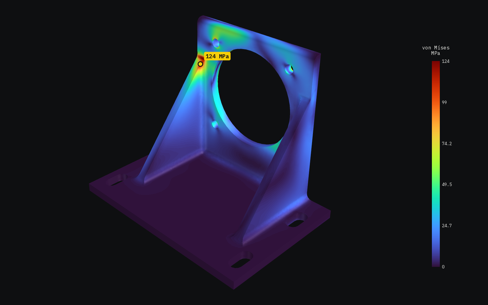
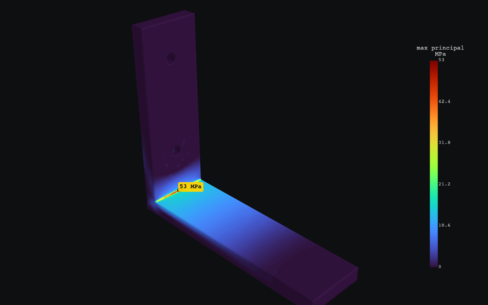
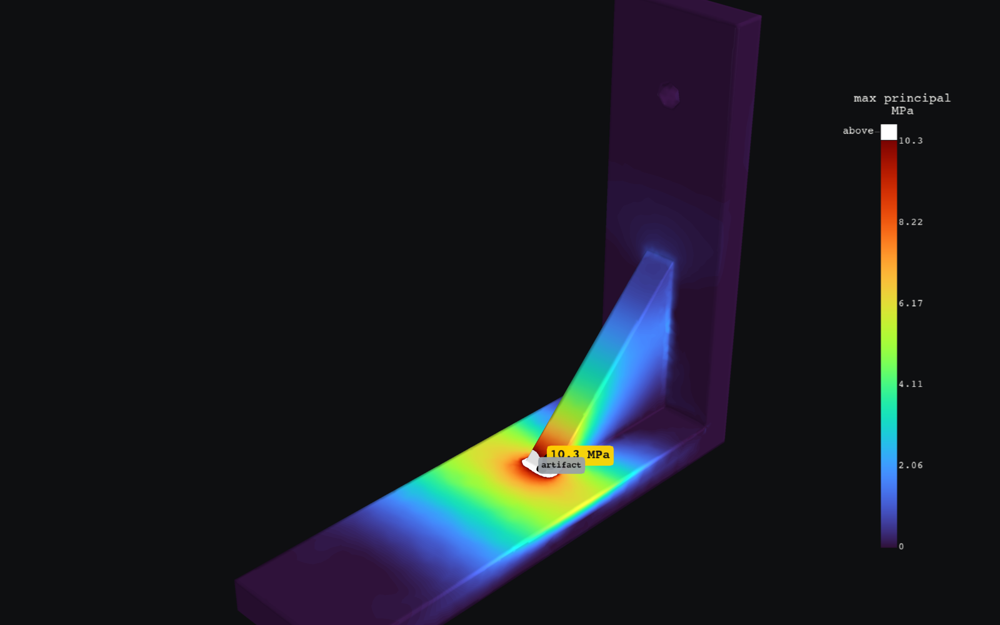

<p align="center">
  <a href="https://sohan-bhat.github.io/wobbl/">
    <picture>
      <source media="(prefers-color-scheme: dark)" srcset="site/assets/logo-dark.svg">
      
    </picture>
  </a>
</p>

<p align="center">
  <strong>Simulate anything before you build it.</strong><br>
  Verified strength, heat and circuit simulation for coding agents and the people who design physical things.
</p>

<p align="center">
  <a href="https://github.com/sohan-bhat/wobbl/actions/workflows/ci.yml"></a>
  <a href="LICENSE"></a>
  <a href="pyproject.toml"></a>
</p>

<p align="center">
  <a href="https://sohan-bhat.github.io/wobbl/">Website</a> &nbsp;|&nbsp;
  <a href="https://sohan-bhat.github.io/wobbl/get-started/">Getting started</a> &nbsp;|&nbsp;
  <a href="https://sohan-bhat.github.io/wobbl/guides/">Guides</a> &nbsp;|&nbsp;
  <a href="https://sohan-bhat.github.io/wobbl/guides/cli/">CLI reference</a> &nbsp;|&nbsp;
  <a href="https://sohan-bhat.github.io/wobbl/examples/">Examples</a>
</p>



<p align="center"><sub>A real Wobbl output, a sand cast motor mount under a 2 kN belt pull, with the peak of 124 MPa at the rib tip and a safety factor of 1.33 against a target of 2.</sub></p>

## What it is

Wobbl is a command line tool, an MCP server and an agent skill that run real
engineering solvers and check every answer before anyone acts on it. Point it at
a STEP, IGES, STL or parametric Python part, ask a question in plain words or
with explicit loads and supports, and you get back the number, where it happens,
a confidence level with its reasons, the assumptions, a heatmap with the failure
point marked and fixes with numbers.

- Strength with [CalculiX](http://www.calculix.de), on second order tetrahedral
  meshes from [gmsh](https://gmsh.info) and OpenCASCADE that are refined around the
  peaks until the stress settles.
- Heat, steady and transient, also with CalculiX.
- Circuits with [ngspice](https://ngspice.sourceforge.io), for LEDs, RC networks,
  buck converters, MOSFETs or any netlist.

`wobbl fix --apply` edits the part, adding fillets and gussets to any STEP file,
and runs the whole study again. The same tools work from your terminal and from
Claude Code, Codex, Cursor and Gemini CLI.

## Quick start

Wobbl needs Python 3.10 or newer and installs from PyPI.

```sh
pipx install wobbl
# or: uv tool install wobbl

wobbl setup     # solvers into ~/.wobbl, MCP server and skill for your agents
wobbl doctor    # check every piece
```

`wobbl setup` downloads a pinned micromamba and installs the solvers from
conda-forge into `~/.wobbl` (about 340 MB, no admin rights). Use
`wobbl setup --no-agents` for solvers only, or `--agents claude,cursor` to pick.

This first answer needs no files.

```sh
wobbl "will a blue LED on 5V with a 47 ohm resistor fry?"
```

Then try your own part.

```sh
# holes, fillets, sharp corners and face ids
wobbl inspect part.step

# ask in plain words, or give the material, supports and loads yourself
wobbl part.step "will this 6061 bracket yield under 50 lbf at the tip?"
wobbl run part.step -m petg --fix "bolt holes d=5.5" \
  --load "250 N down at 0,-15,31 @ holes d=3.4 rigid"

# build the fixes (fillets, gussets, thicker walls) and run each again
wobbl fix wobbl-out/part --apply
```

Or run a bundled example, which takes a few minutes.

```sh
git clone https://github.com/sohan-bhat/wobbl
cd wobbl/examples/shelf-bracket && ./run.sh
```

| Platform | CalculiX | ngspice |
|---|---|---|
| macOS Apple Silicon | native | Intel build under Rosetta 2 |
| macOS Intel | native | native |
| Linux x86_64 | native | native |
| Linux arm64 | native | not packaged, so install it with your package manager and Wobbl finds it |
| Windows x64 | native | native |

## Example output

This is a printed PLA shelf bracket, screwed to a wall and carrying its share of
an 8 kg shelf. Every run writes `summary.txt`, which is what an agent reads, along
with `report.html`, `outcome.json`, heatmaps and `result.vtu` for ParaView.

```console
$ cd examples/shelf-bracket
$ wobbl run bracket.py -m pla --fix "bolt holes d=4.5" --fix "wall x=min" \
    --load "40 N down @ top and within 12 of 65,12.5,6" -o output
$ cat output/summary.txt
FAILS. Peak 52.3 MPa on the 0.5 mm inside fillet (face 3) at (6.19, 12.6, 6.11). The part cracks at about 0.96x this load.

Confidence: high. passed mesh convergence, force balance, hand calculation, singularities, bolt bearing, units and sanity
Max deflection 3.47 mm at (90, 0, 6).

Checks:
  [pass] mesh convergence: max principal stress settled: 43 -> 50.9 -> 53 -> 52.3 MPa over 4 meshes, last change 1.4%
  [pass] force balance: reactions balance the loads to 0.00014% (forces) and 8.4e-06% (moments)
  [pass] hand calculation: beam theory through the critical section gives 15.2 MPa nominal; FEA peak is 3.45x that, a stress concentration of about 3.4 from the local shape
  [pass] singularities: no sharp corner or support artifact is above the reported stress
  [pass] bolt bearing: worst hole of fix1 (d 4.5 mm) carries 2.7 N sideways and 45.7 N along its axis; bearing stress 0.1 MPa, safety factor 499.33 on bearing
  [pass] units and sanity: part 123 mm across, peak strain 0.015, max deflection 3.47 mm (2.8% of size): all plausible

Suggested fixes:
  - Stress piles up in the 0.5 mm fillet. A fillet of 3 mm (about half the 6 mm wall) spreads it out. ...
  - The peak sits where two walls meet and bend. A gusset as thick as the wall ...
```

`wobbl fix output --apply` then builds each fix and solves it again.

| Version | Peak stress | Safety factor (PLA, 50 MPa) | Verdict |
|---|---|---|---|
| As drawn, 0.5 mm corner | 52.3 MPa | 0.96 | fails |
| 3 mm fillet | 24.1 MPa | 2.08 | marginal (target 2.5) |
| Legs thickened to 10 mm | 21.0 MPa | 2.38 | marginal |
| Gusset across the corner | 9.82 MPa | 5.09 | holds |

<p>
  
  
</p>

## An agent on its own versus Wobbl

Given a CAD file, a strength question and 15 minutes, a capable coding agent
working alone answered in 1 of 10 trials across six
parts. Its hand calculations on beam like parts were good, within 1 to 5%. On the
ribbed cast motor mount and the thin walled enclosure, the two parts that
actually fail, it delivered nothing in six trials, because it kept writing its own
finite element code and hitting the same traps, such as meshers folding thin curved
walls, singular peaks at bonded bolts and load idealizations that flip the verdict.

Wobbl answers the same parts in minutes and handles each of those traps by default.

| Part | Converged reference | Wobbl | Confidence |
|---|---|---|---|
| Cast motor mount, belt pull through four bolts | 124.3 MPa at the rib tip | 123.7 MPa, same spot | medium, because the verdict flips if the servo is treated as rigid (55.0 versus 124 MPa), and Wobbl says so |
| ABS enclosure shell pressed near a corner | 93 MPa, 1.93 mm deflection | 93.0 MPa, 1.92 mm | medium, because large deflection theory lowers the peak 11%, and Wobbl says so |
| PA12 truss drone arm, thrust and torque | 11.5 MPa, 4.09 mm rise | 11.49 MPa, 4.08 mm | high |
| PLA bracket, sharp inside corner | about 78 MPa | 80.5 MPa | high |

The full comparison, with times and every trap, is [on the website](https://sohan-bhat.github.io/wobbl/validation/bakeoff/).

## Using it from agents

`wobbl setup` registers an MCP server and installs a skill for every coding
agent it finds, backing up each file it touches. `wobbl uninstall` removes
exactly what it added.

| Agent | MCP server | Skill or context |
|---|---|---|
| Claude Code | `claude mcp add --scope user wobbl` | `~/.claude/skills/wobbl/SKILL.md` |
| Codex | `[mcp_servers.wobbl]` in `~/.codex/config.toml` | `~/.codex/skills/wobbl/SKILL.md` |
| Cursor | `mcpServers.wobbl` in `~/.cursor/mcp.json` | `~/.cursor/skills/wobbl/SKILL.md` |
| Gemini CLI | extension at `~/.gemini/extensions/wobbl/` | `WOBBL.md` in the same extension |

The agent gets 13 tools, `inspect_geometry`, `mesh`, `new_study`,
`set_material`, `apply_load`, `add_fixture`, `solve_structural`, `verify`,
`render`, `suggest_fix`, `solve_thermal`, `solve_circuit` and `list_materials`.
Results are compact JSON with image and report paths. The skill teaches the
workflow and what never to skip, which means reading the checks before the number,
never quoting an excluded peak and making the supports match the real build.

```text
> Will this printed PLA shelf bracket hold its share of an 8 kg shelf?

agent: solve_structural(path="bracket.py", material="pla",
                        fixtures=["bolt holes d=4.5", "wall x=min"],
                        loads=["40 N down @ top and within 12 of 65,12.5,6"])
       verdict fails, 52.3 MPa on the 0.5 mm inside fillet, safety factor 0.96, confidence high
agent: suggest_fix(result_dir, apply=true)
       3 mm fillet 24.1 MPa (2.08), legs at 10 mm 21 MPa (2.38), gusset 9.82 MPa (5.09)
```

Strength studies take one to seven minutes on a 2018 laptop. Each agent's setup, the
timeouts and every tool are [on the website](https://sohan-bhat.github.io/wobbl/guides/agents/).

## What it checks

Every strength answer runs these checks and turns them into a confidence level,
high, medium or low, always with the reasons. A result that failed a check is
never reported as high confidence.

- Mesh convergence over at least three meshes, refined around the peaks that matter.
- Force and moment balance, with the reactions cancelling the loads to 0.5%.
- A hand calculation with beam theory through the critical section, and a check that the stress concentration is physical.
- Singularities, with sharp inside corners found from exact CAD normals and the peaks there and at idealized supports excluded, named and tracked.
- Load introduction, where off part loads are solved both rigid and distributed, each converged at its own peak, and the spread is reported.
- Bolt bearing at bolted holes, in place of the idealized peak.
- Units and sanity for the part size, peak strain and deflection.
- Large deflection, a nonlinear re-solve when the part bends a good fraction of its wall.

Heat answers check energy balance and a lumped hand calculation, and circuit
answers are compared with the textbook and run again at half the time step. Every
study has a time budget, and when it runs out the last finished mesh level comes
back with its checks. The same input gives the same answer on every run, because
meshing, wall thickness sampling and the budget are all deterministic. The website
explains every [check](https://sohan-bhat.github.io/wobbl/guides/results/checks/) and how the
[confidence](https://sohan-bhat.github.io/wobbl/guides/results/confidence/) is set.

## Validation

Eighteen cases with known answers run through the same pipeline you get. Every
case passes its tolerance, and every case whose reference is exact for the
modeled setup lands within 2%.

| Group | Cases | Largest error |
|---|---|---|
| Textbook and benchmark strength (Timoshenko, Kirsch, Lame, NAFEMS LE1 and LE10, torsion, self weight) | 8 | 1.54%, plate with a hole |
| Real parts against converged reference models | 5 | 4.26%, PLA bracket with a 6 mm fillet |
| Heat (slab conduction, lumped cooling) | 2 | 0.44% |
| Circuits (LED, RC, buck ripple) | 3 | 7.70%, buck ripple against an ideal formula that ignores switch and diode drops |

The full table is [on the website](https://sohan-bhat.github.io/wobbl/validation/). Run it yourself with
`wobbl validate`, which takes about 30 minutes.

## Examples

Each folder in [`examples/`](examples) is a real product with its real outputs, the
reports, heatmaps and summaries, and each has a page [on the website](https://sohan-bhat.github.io/wobbl/examples/).

| Example | Question | Domain |
|---|---|---|
| [cast-motor-mount](examples/cast-motor-mount) | Does a cast motor mount meet a safety factor of 2 under a 2 kN belt pull? | strength, remote loads |
| [shelf-bracket](examples/shelf-bracket) | Does a printed PLA bracket hold an 8 kg shelf, and what fixes it? | strength, fixes |
| [motor-mount](examples/motor-mount) | Do the ribs on a printed NEMA 17 mount earn their keep? | strength |
| [enclosure](examples/enclosure) | Does a PC enclosure survive a thumb press, and how far does it dent? | strength, thin walls |
| [drone-arm](examples/drone-arm) | Is a PA12 drone arm strong enough at full throttle? | strength, rigid loads |
| [heat-sink](examples/heat-sink) | Does a 15 W chip stay under 85 C without a fan? | heat |
| [battery-pack](examples/battery-pack) | When does a pack in a sealed box pass 60 C? | transient heat |
| [circuits](examples/circuits) | Will this LED fry? What is the ripple? How hot is the MOSFET? | circuits |

Each folder has a `run.sh` that regenerates its outputs.

## Documentation

- [Getting started](https://sohan-bhat.github.io/wobbl/get-started/), to install, set up and run a first study
- [Guides](https://sohan-bhat.github.io/wobbl/guides/) for strength, heat and circuits, the inputs, the results and fixing parts
- [CLI reference](https://sohan-bhat.github.io/wobbl/guides/cli/) with every command and option
- [Agents and MCP](https://sohan-bhat.github.io/wobbl/guides/agents/) with what `wobbl setup` registers, the 13 tools and the skill
- [How it checks itself](https://sohan-bhat.github.io/wobbl/guides/results/checks/), every check and what sets the confidence
- [Validation](https://sohan-bhat.github.io/wobbl/validation/), the 18 cases and their setups
- [Bake-off](https://sohan-bhat.github.io/wobbl/validation/bakeoff/), a coding agent on its own versus Wobbl
- [Contributing](https://sohan-bhat.github.io/wobbl/get-started/contributing/), with the architecture and how a new solver plugs in
- [Publishing](docs/publishing.md), the release steps for PyPI
- [Changelog](CHANGELOG.md)

## Limits

- Materials are linear elastic, so Wobbl reports whether yield is reached but not
  what happens after, and large deflection is checked with a nonlinear re-solve.
- Loads are static, and fatigue, impact and vibration are not modeled yet.
- Contact is limited to rigid walls the part can push on but not pull, and bolted
  joints are modeled as clamped holes without preload.
- Each study uses one material, and assemblies of touching bodies are bonded.
- Thin walls are slow, since 2 to 3 mm shells on 100 mm parts need large
  tetrahedral meshes and take several minutes, and shell elements are on the roadmap.
- Printed plastics are treated as isotropic at 100 percent infill, with a layer
  strength knockdown when you give the print direction.

Shell elements, fatigue estimates and bolt preload come next in 0.2, then CFD with
OpenFOAM in 0.3 and motion with MuJoCo in 0.4.

## Contributing

Issues and pull requests are welcome, and this is how to work on Wobbl itself.

```sh
git clone https://github.com/sohan-bhat/wobbl && cd wobbl
python -m pip install -e ".[dev]"
python -m pytest -m "not solver"      # fast unit tests
wobbl setup --no-agents               # CalculiX and ngspice
python -m pytest -m solver            # end to end tests with the solvers
```

A new solver plugs in as one adapter class, as
[contributing](https://sohan-bhat.github.io/wobbl/get-started/contributing/) explains. If you change the physics, add or update a
case in `src/wobbl/validation/cases.py` so `wobbl validate` covers it.

## License

[MIT](LICENSE), copyright Sohan Bhat.

---

<p align="center"><a href="https://sohan-bhat.github.io/wobbl/">sohan-bhat.github.io/wobbl</a></p>
