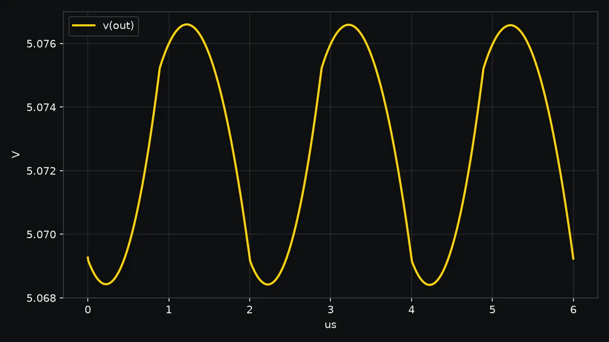

# Circuits

LEDs, RC networks, buck converters, MOSFETs or any netlist, simulated with
ngspice and compared with the textbook answer.

## Will this LED fry?

```sh
wobbl circuit led --set supply=5V --set resistor=47 --set led=blue
```

```text
FAILS. The LED fries: 36.9 mA through it, above its 30 mA rating (1.2x).

Checks:
  [pass] hand calculation: diode equation solved by hand gives 36.9 mA, ngspice 36.9 mA (5.4e-05% apart); the quick estimate (Vs - Vf)/R is 38.3 mA
  [pass] power balance: supply gives 184 mW = resistor 63.9 mW + LED 120 mW (5.4e-08% apart)

Suggested fixes:
  - Use a 91 ohm resistor: Gives about 19.8 mA; it dissipates 35.6 mW, so a 0.25 W part is enough.
```

LED colors are red, orange, yellow, green, blue, white, uv, ir, power-white and
power-red. Override the forward voltage and rating with `vf=` and `imax=`.

## How much ripple on a buck converter?

```sh
wobbl circuit buck --set vin=12 --set vout=5 --set current=2 --set frequency=500k \
  --set inductor=10u --set capacitor=22u --set max_ripple=0.05
```



8.56 mV peak to peak on 5.07 V, within the 50 mV limit. The ideal formula gives
7.95 mV; the switch and diode drops that ngspice models explain the gap. The
run is repeated at half the time step, and the ripple agrees to 0.0022%.

## How hot does a MOSFET get?

```sh
wobbl circuit mosfet --set current=15 --set rds_on=8m --set frequency=20k \
  --set theta_ja=40 --set ambient=50
```

About 110 C at the junction (1.51 W), under the 150 C limit. Wobbl iterates the
junction temperature with the on resistance rising 0.6% per degree, which also
catches thermal runaway.

## Any netlist

```sh
wobbl circuit board.cir --probe "v(out)" --probe "i(V1)"
```

A netlist with a `.tran` analysis is run again at half the time step to check
that the answer has settled.

[All three circuits, with reports](../examples/circuits)
