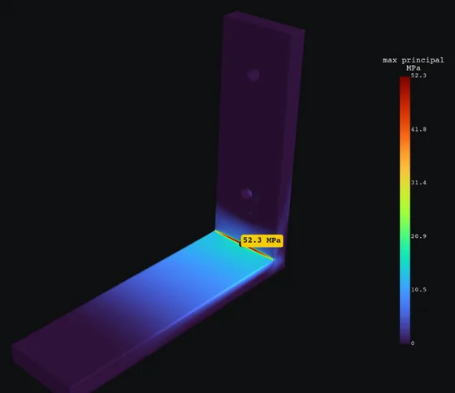
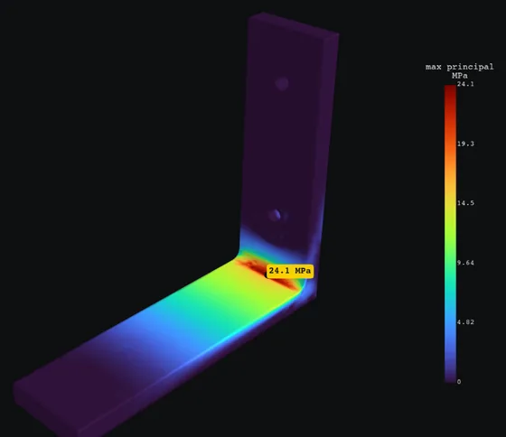
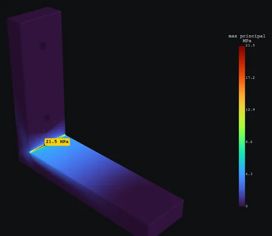
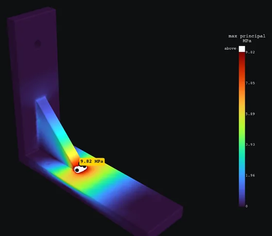

# Fix a failing part

`wobbl fix` turns the suggestions in a result into edited parts, solves each one
again and lines up the numbers.

```sh
wobbl fix wobbl-out/bracket            # list the fixes, each with the number it needs
wobbl fix wobbl-out/bracket --apply    # build them and run the study again for each
wobbl fix wobbl-out/bracket --apply --only fillet,gusset
```

## The shelf bracket, four ways

<p class="img-row">
  
  
  
  
</p>

| Version | Peak stress | Safety factor (PLA, 50 MPa) | Verdict |
|---|---|---|---|
| As drawn, 0.5 mm corner | 52.3 MPa | 0.96 | fails |
| 3 mm fillet | 24.1 MPa | 2.08 | marginal (target 2.5) |
| Legs thickened to 10 mm | 21.0 MPa | 2.38 | marginal |
| Gusset across the corner | 9.82 MPa | 5.09 | holds |

Thicker legs barely help, because the sharp corner still multiplies the stress.
Rounding or bracing the corner is what works. The gusset's own toe is a sharp
corner, which Wobbl excludes as a singularity and flags with medium confidence,
so give it a small fillet in the real part. Each heatmap is scaled to its own
peak. [Shelf bracket example](../examples/shelf-bracket)

## What it suggests

- a fillet at the peak, about half the wall thick
- a thicker wall, with the thickness the target needs (bending stress falls with
  thickness squared)
- a gusset across the corner where two walls meet and bend
- a stronger material, with the safety factor each one gives
- a shorter lever arm, with the distance that reaches the target

## What it applies

Fillets and gussets go into any STEP file through OpenCASCADE, and the edited
STEP is saved next to the results for your CAD tool. On a parametric part,
Wobbl changes its thickness and fillet parameters. Material swaps re-run the
same geometry. A thicker wall on a STEP file and a shorter lever arm stay
numbers for you to apply.

From an agent, `suggest_fix(result_dir, apply=true)` does the same and returns
the before and after.
