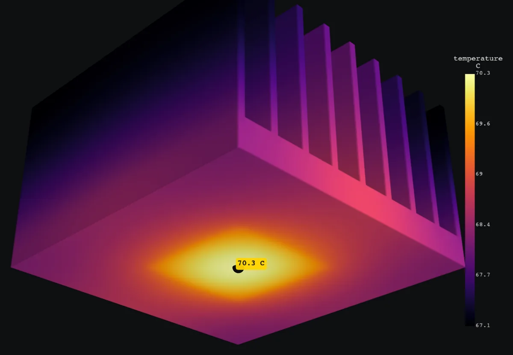
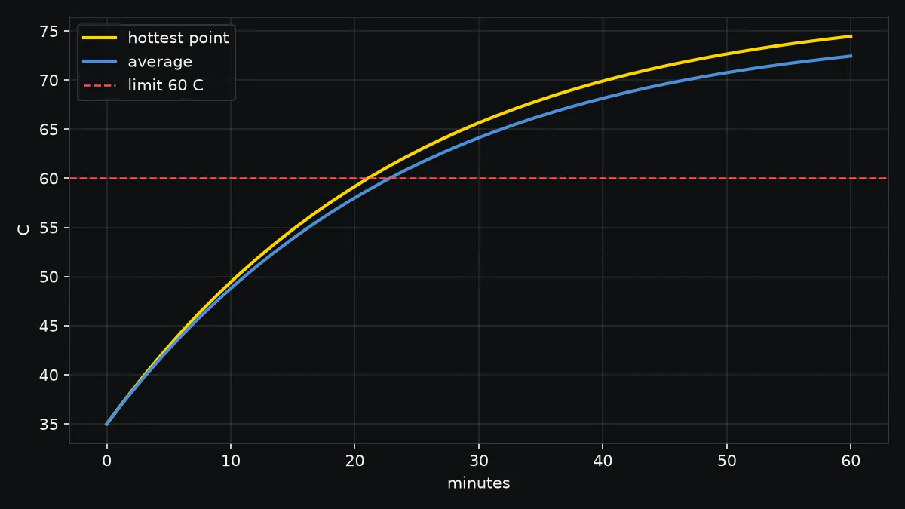

# Heat

Steady and transient temperatures with convection, radiation and held
temperatures, solved with CalculiX.



## A chip on a heat sink

```sh
wobbl thermal heatsink.py -m 6063-t5 --power "15 W" \
  --heat-faces "bottom and box 17.5,17.5,-1,42.5,42.5,0.5" \
  --film "6 W/m2K @ all" --ambient "40 C" --radiation 0.85 --limit "85 C"
```

The 15 W goes in through the 25 mm square the chip touches. Still air in a
40 C cabinet takes heat away at about 6 W/(m2 K), and the anodized surface
radiates. Without `--duration` the run is steady state.

```text
OK. Hottest point reaches 70.3 C (limit 85 C) at (30, 29.9, 0) mm at steady state.

Confidence: high. passed mesh convergence, energy balance, hand calculation, units and sanity
  [pass] mesh convergence: temperature rise at the hottest point settled: 30.3 -> 30.2 -> 30.3 C over 3 meshes, last change 0.2%
  [pass] energy balance: heat in 15 W, heat out through the surfaces 15 W (3.1e-07% apart)
  [pass] hand calculation: heat balance on a uniform skin gives 68.1 C; the FEA skin averages 68.1 C (0.0029% of the rise). Biot 3.1e-05: the part is nearly isothermal
```

[Heat sink example](../examples/heat-sink)

## A battery pack over an hour

```sh
wobbl thermal pack.py -m li-ion-cell --power "6 W" --film "5 W/m2K @ all" \
  --ambient "35 C" --radiation 0.9 --duration "60 min" --limit "60 C"
```

`--duration` makes it a transient run, and Wobbl reports when the limit is
crossed. This 2S2P pack in a sealed box passes 60 C after about 21 minutes and
reaches 74.5 C at one hour.



[Battery pack example](../examples/battery-pack)

## Choosing the inputs

| Input | How to set it |
|---|---|
| heat made in the part | `--power "12 W"`, spread through the volume |
| heat from a chip | `--power` with `--heat-faces` on the faces it touches |
| cooling by air | `--film`: still air in a box about 5 W/(m2 K), open air 10, a small fan 25, strong forced air 60, water 500 |
| a held temperature | `--fixed-temp "40 C @ bottom"` |
| radiation | `--radiation 0.9` for painted or plastic surfaces |
| the limit | `--limit "60 C"`, or the material's service limit |

Every option is in the [command reference](cli.md#wobbl-thermal). Heat answers
are checked by energy balance and a lumped hand calculation:
[how Wobbl checks an answer](verification.md#heat).
