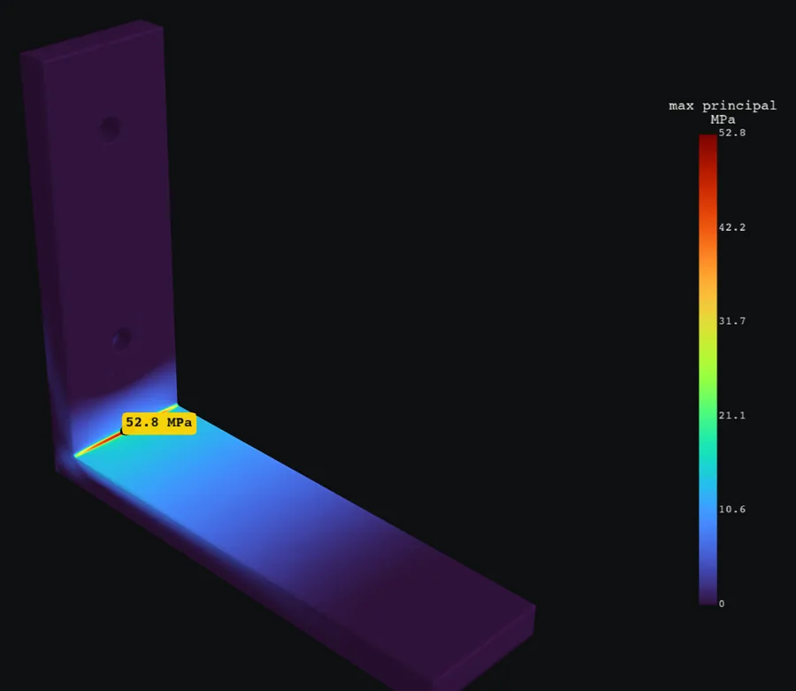

# Check a part's strength

Hold the part the way the real one is mounted, load it, and read the verdict
with the checks behind it.



This guide follows the [shelf bracket example](../examples/shelf-bracket): a
printed PLA L bracket screwed to a wall, carrying 40 N of an 8 kg shelf.

## Look at the part

```sh
wobbl inspect bracket.py
```

You get the size, wall thickness, holes with their diameters, fillet radii,
sharp inside corners and the largest faces with their ids. Those give you the
names to point at: `hole d=4.5`, `x=min`, `face 9`.

Parts can be STEP, IGES, BREP, STL or a [parametric Python file](#parametric-parts).
Geometry is read in millimeters; `--scale 25.4` converts a file drawn in inches.

## Choose the material

```sh
-m pla
```

`wobbl materials` lists the 23 built in materials, each with its source and how
it is made (printed, molded, cast or wrought). For anything else, give the
values: `custom:E=72400,nu=0.33,yield=165,process=cast`. To change one property,
`pla:yield=40`. For a print, `--print-direction z` judges pull across the layers
against the weaker layer strength.

## Hold it like the real build

```sh
--fix "bolt holes d=4.5" --fix "wall x=min"
```

Two screws through the 4.5 mm holes, and the back of the upright rests on the
wall, free to lift off. A support can be fixed, fixed in some directions, a
bolted hole with its washer ring, a roller that slides in its plane, or a wall
the part pushes on. Wobbl will not solve a part that is not held, and names the
motion that is free. See [all support kinds](cli.md#supports).

## Load it

```sh
--load "40 N down @ top and within 12 of 65,12.5,6"
```

40 N pushing down on a 12 mm patch of the top face, 65 mm from the wall. A load
can be a force, a pressure, a bolt bearing on a hole, gravity, or a force or
torque at a point off the part, like a belt pull at a pulley. Any common unit
works: `N`, `kN`, `lbf`, `MPa`, `psi`, `N*m`, `g`. See
[all load kinds](cli.md#loads).

## Point at faces

The text after `@` picks faces:

```text
top   x=min   z>5   normal +z   hole d=4.5   holes d<6   fillets
face 12   within 15 of 50,-25,35   top and within 12 of 65,12.5,6
```

Run `wobbl inspect` first and it tells you which ones exist on your part. See
[every selector](cli.md#selecting-faces).

## Run it

```sh
wobbl run bracket.py -m pla --fix "bolt holes d=4.5" --fix "wall x=min" \
  --load "40 N down @ top and within 12 of 65,12.5,6"
```

Wobbl meshes the part, solves it with CalculiX, refines around the peaks until
the stress settles and runs its checks. This one takes about two minutes.

You can also ask in plain words, `wobbl bracket.py "will this PLA bracket crack
under 40 N?"`. Wobbl then guesses what the question leaves out, such as the
supports and where the load goes, and prints each guess as an assumption.

## Read the answer

```text
FAILS. Peak 52.3 MPa on the 0.5 mm inside fillet (face 3) at (6.19, 12.6, 6.11). The part cracks at about 0.96x this load.

Confidence: high. passed mesh convergence, force balance, hand calculation, singularities, bolt bearing, units and sanity
Max deflection 3.47 mm at (90, 0, 6).
```

The verdict is holds, marginal or fails, against the material's limit and the
safety factor you ask for with `--target-sf` (by default 1.5 for metals and 2.5
for printed plastics). Read the confidence and its reasons before the number:
[how Wobbl checks an answer](verification.md).

For a quick look, `--quality fast` stops at two meshes. `--budget` sets the
seconds the study may spend, 300 by default.

## Parametric parts

A part can be a short Python file instead of a STEP file:

```python
PARAMS = {"thickness": 6.0, "fillet": 0.5}

def build(occ, thickness, fillet):
    arm = occ.addBox(0, 0, 0, 90, 25, thickness)
    ...
```

`occ` is OpenCASCADE through gmsh (`addBox`, `addCylinder`, `fuse`, `cut`,
`fillet`, `extrude`). Override a value with `--param fillet=3`, and
`wobbl fix --apply` changes the parameters itself. The examples are complete
parts to start from.
