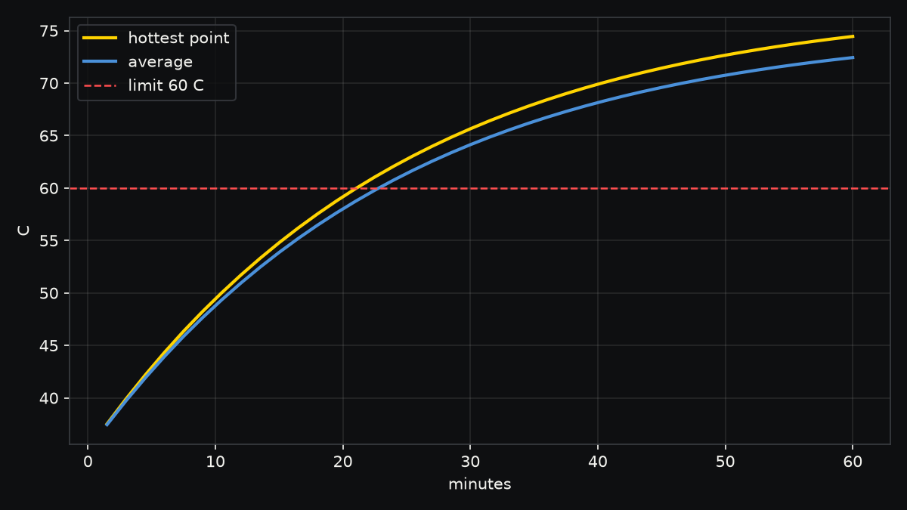

# Battery pack: when does it pass 60 C in a sealed box?

A 2S2P pack of 18650 cells, treated as one 37 x 37 x 65 mm block with
effective cell properties, making 6 W during a one hour discharge inside a
sealed plastic box at 35 C. Still air gives about 5 W/(m2 K), and the wrap
radiates with emissivity 0.9.

```sh
./run.sh
```

| Result | Value |
|---|---|
| Hottest point after 60 min | 74.5 C, over the 60 C limit for Li-ion cells |
| Time to pass 60 C | about 22.5 minutes |
| Hand calculation | a lumped model with convection and radiation gives a mean of 72.2 C at 60 min; the FEA mean is 72.8 C |



The pack heats almost uniformly (Biot number 0.012), so the answer is set by how
fast the box sheds heat. Either the box needs airflow or a path to a metal wall,
or the discharge has to stay under about 3.5 W to hold 60 C for the hour.
