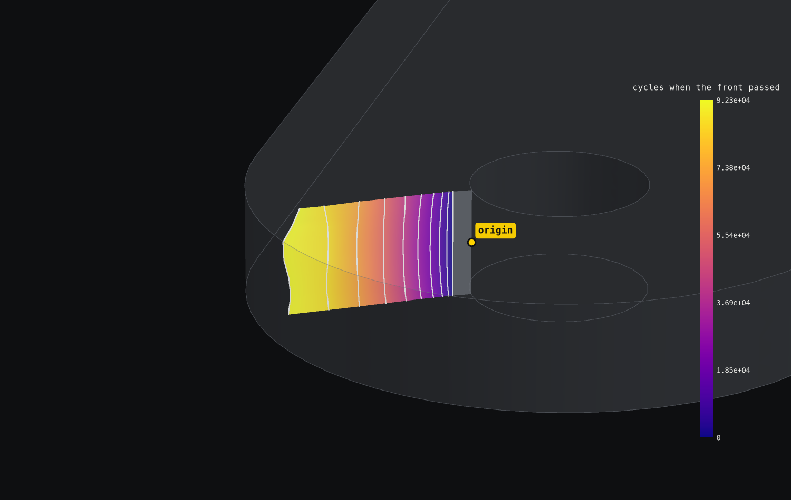

# Bracket crack

Where does a crack at the pin hole go, and do 99% of brackets last 100,000 cycles?

A machined 7075-T6 bracket bolts down through two 6.6 mm holes, and its arm ends in a lug whose 8 mm pin
pulls with 4 kN at 30 degrees to the arm, cycling between 10% and 100% of that load (R = 0.1). The
question starts from a 1.27 mm crack through the lug's 5 mm wall at the pin hole, the flaw damage
tolerance practice assumes at a hole.

```sh
./run.sh
```

| Result | Value |
|---|---|
| Typical bracket | fails after about 83,400 cycles |
| One in ten | fails by 53,200 cycles |
| One in a hundred (B1) | fails by 36,600 cycles |
| Share failing before 100,000 cycles | 71.5%, against 1% allowed |
| Inspection | every 41,700 cycles |
| Hand calculation | a weight function over the uncracked stress gives 7.77 MPa sqrt(m) for the starting crack, the finite element K is 7.17 |



The crack starts where the bore is most stressed, at (91.7, -3.6, 2.5), grows straight out through the lug
over ten solved steps and cuts the wall at about 9 mm, where K climbs from 7.2 to 15 MPa sqrt(m). A
Monte Carlo over 20,000 brackets with scattered starting flaws, growth constants, loads and toughness
gives the spread above. Wobbl suggests cutting the stress at the bore by 21%, through a larger lug or a
smaller load, a steel lug, or inspecting every 41,700 cycles.

`output/playback.json` holds the part's surface, every solved front with its K and the cycle count when
it passed, the growth curve, the spread of lives and the lives at each load. The report's 3D view shows the
crack at the end of its path with a load slider. K scales exactly with the load, and the life of one part in a
hundred and the share failing before the target follow it.
