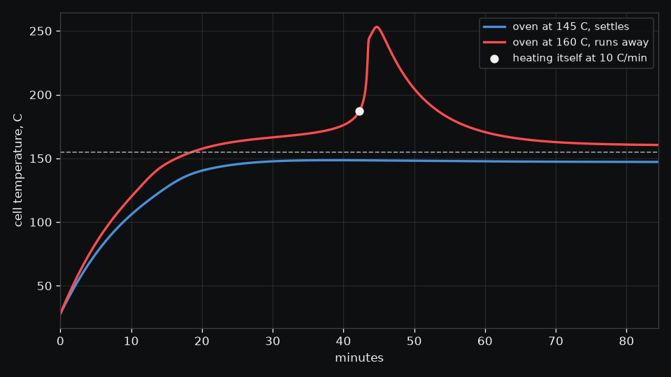

# Cell runaway

Can a cell at the hottest point of the sealed battery pack run away on its own?

The [battery pack](../battery-pack) example finds its hottest point reaching 74.5 C during a one
hour discharge in a sealed box. This run takes that temperature straight from the pack's result as
the surroundings of one charged 18650, cooled by the still air of a sealed box at 5 W/(m2 K), and
asks at what surrounding temperature the cell's own decomposition would outrun its cooling.

```sh
./run.sh
```

| Result | Value |
|---|---|
| Thermal runaway onset | 155 C, the lowest surrounding temperature at which the cell heats itself faster than 10 C/min |
| Surroundings | 74.5 C, from the pack's heat study |
| Margin | 80.4 K |
| Semenov estimate | 107 C with fresh reactants that never run out, the classical bound |



Self heating cannot run away at the pack's temperature, so the risk in this pack is the 60 C
service limit the heat study already flags, not runaway. The onset comes from Hatchard's kinetics
for a fully charged LiCoO2 cell, and in Wobbl's validation the same model lands within a kelvin of
the 155 C that Hu, He, Rein and Restuccia's model and Hatchard's oven tests give for a cell cooled
at 7.17 W/(m2 K). The Semenov bound sits lower because the
cell's small store of SEI burns out before it can carry the cell on its own. Other chemistries run
away at other temperatures, so for them the answer is indicative, and what happens after the
trigger, venting and fire, is beyond these kinetics. The output folder also holds `playback.json`,
the two oven runs frame by frame with how much of each reactant is left.
