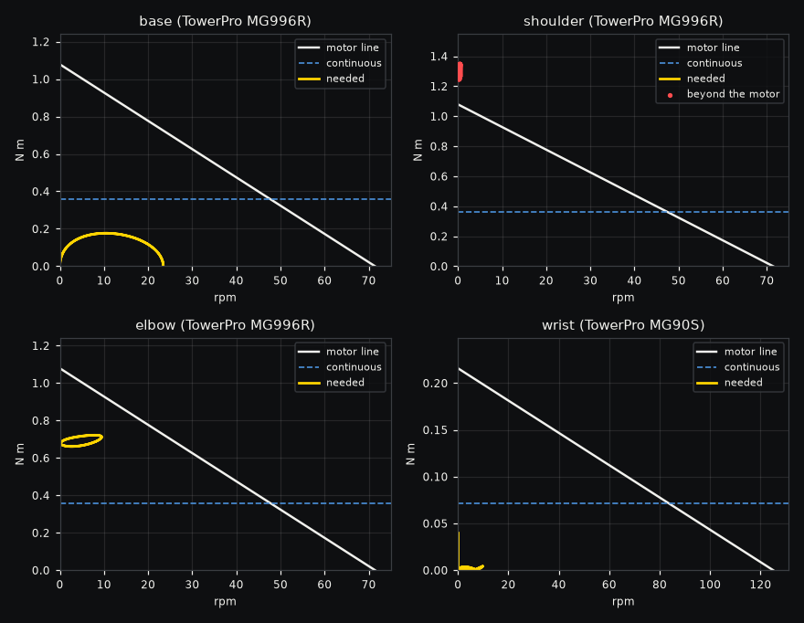
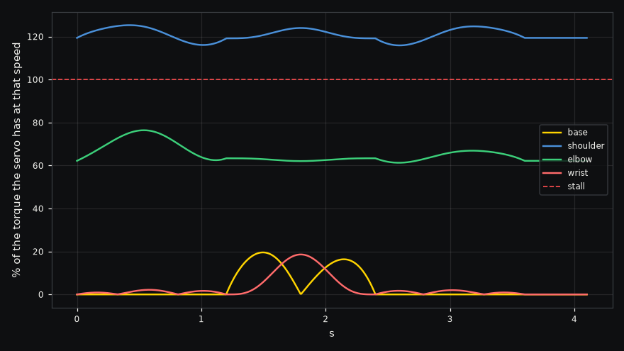

# Desktop arm

Can these hobby servos lift a 500 g payload through this desktop arm's pick and place?

A printed desktop arm stands on a base screwed to the table, with a base servo turning it, a 120 mm upper
arm, a 120 mm forearm and a 60 mm hand that keeps its gripper pointing down. The base, shoulder and elbow
are TowerPro MG996R servos at 6 V, rated 11 kg cm at stall, and the wrist is an MG90S. The printed links
weigh 60, 50 and 30 g and the gripper 40 g. The move picks the payload at 200 mm in front of the base,
lifts it 80 mm, swings a quarter turn, lowers it at 200 mm to the side and holds it there, each step taking
1.2 s.

```sh
./run.sh
```

| Result | Value |
|---|---|
| Verdict | fails, because the shoulder stalls |
| Shoulder | needs 1.35 N m (13.7 kg cm) almost at rest, where the MG996R gives 1.07 N m (11 kg cm) |
| Elbow | needs 0.72 N m at 9 rpm, 76% of what its MG996R gives at that speed |
| Heat | over the repeating cycle the shoulder averages 1.30 N m RMS and the elbow 0.69 N m against about 0.36 N m each can carry continuously |
| Hand statics | the moments of the weights about the shoulder and elbow at the pick point, 1.29 and 0.671 N m, match MuJoCo's inverse dynamics exactly |
| What the run shows | the shoulder is pinned at its limit from the start, and the hand drops onto the table at 0.24 s |



The shoulder is short of torque before the arm even moves. Holding 500 g, the 40 g gripper, the wrist
servo and the forearm out at 200 mm takes 1.29 N m, about a fifth more than the MG996R's stall torque, so
the arm sags as soon as it is let go. The elbow can just make the move once, but like the shoulder it would
cook if the arm repeated it all day, because a hobby servo can carry only about a third of its stall torque
for long.

Every fix was checked by solving the whole move again with the change in place.

| Fix | Result of solving again |
|---|---|
| A 5:1 belt or gear stage on the shoulder and 2.5:1 on the elbow | the busiest servo uses 44% of its torque at speed and the warmest 85% of its continuous rating |
| A Dynamixel XM430-W350 at the shoulder and a DS3218 at the elbow | 39% and 98% |
| A 0.64 N m spring on the shoulder, or 660 g on a 100 mm tail | the shoulder drops to 83% of its torque but still runs hot |
| A lighter payload | these servos make a single move with up to about 368 g, and carry about 25 g all day |



The needs come from MuJoCo's inverse dynamics along the move, which is exact for rigid links, and a
second run with each servo held to its torque speed line shows what really happens. That run falls 83
degrees behind the move and its collapse repeats at half the time step to 0.02%. Its energy account
closes to 0.11%. The links are rigid and the servos' rotors behind their gearboxes are given the inertia
of a 20 ms mechanical time constant, since servo datasheets leave it out.

Every joint's angle, speed and torque through the run, and where the payload went, are in
`output/trajectory.csv`. `output/playback.json` holds the arm as simple shapes with their poses through
the run and each servo's torque beside its limit, so the arm can be watched trying to lift the payload with
each servo's load shown live.
