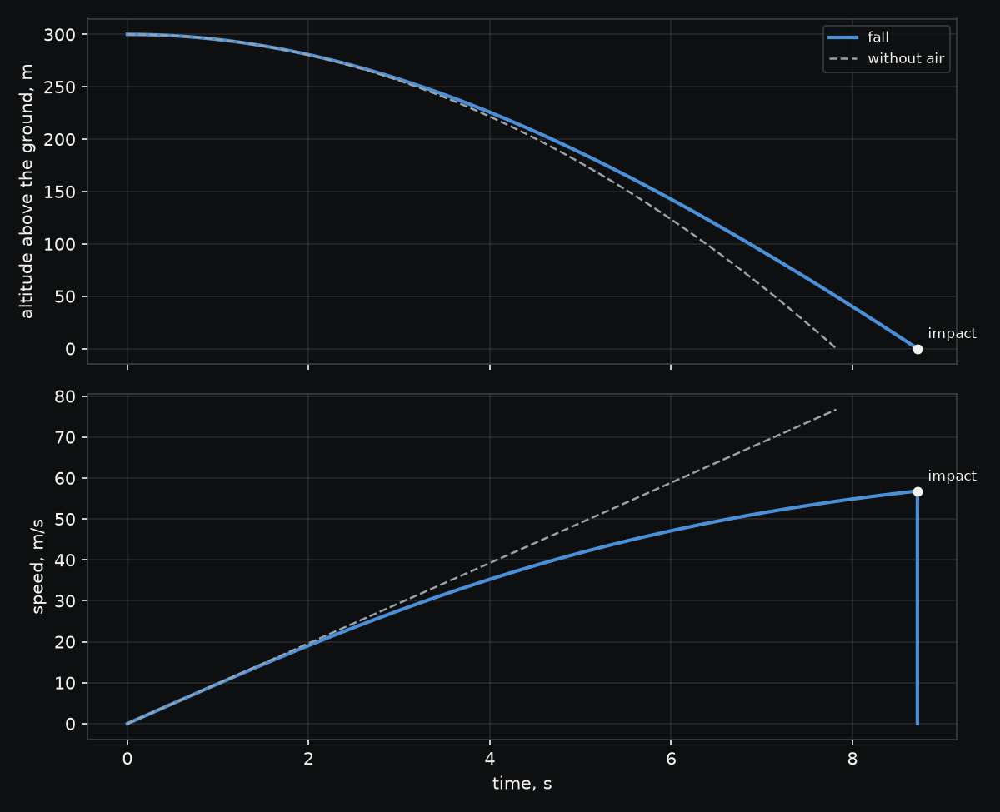

# Falling rock

How fast does a rock hit the ground after a 300 m fall?

This is the simplest thing Wobbl can simulate. A fist sized lump of granite, taken as a sphere 9 cm
across at 2700 kg/m3 so it weighs 1.03 kg, drops from rest off the top of a 300 m cliff. A tumbling
rock averages a drag coefficient of about 0.6 on its frontal area, and the air is the 1976 standard
atmosphere, about 3% thinner at the top of the cliff than at its foot.

```sh
./run.sh
```

| Result | Value |
|---|---|
| Fall time | 8.72 s, against 7.82 s without air |
| Impact speed | 56.8 m/s (205 km/h), against 76.7 m/s without air |
| Terminal speed | 66.2 m/s, which the rock never quite reaches |
| Hand calculation | the quadratic drag solution, with the air's density taken halfway down, gives 8.72 s and 56.9 m/s |
| Energy balance | gravity gives 3.03 kJ and drag takes 1.37 kJ, which leaves the 1.66 kJ the impact speed carries |



For the first two seconds the rock falls almost exactly as it would in a vacuum, because drag grows
with the square of its speed. After that drag catches up, and by the ground it takes a quarter off the
impact speed and adds nearly a second to the fall. The same run with the air taken away and gravity
held at its ground value lands when sqrt(2h/g) says it should, agreeing to more than ten digits, and
every number above held when the flight was integrated again with a tolerance ten times tighter.

The trajectory is in `output/trajectory.csv`, one row per moment of the fall with time, height, speed,
acceleration, Mach number and dynamic pressure.
