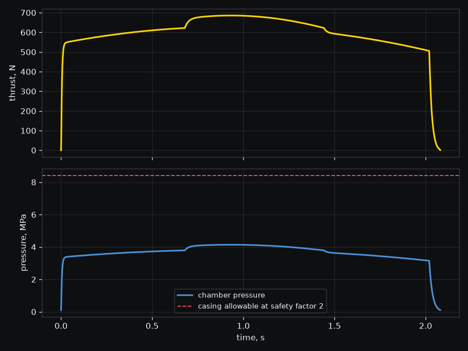

# KNSB motor

Will this 54 mm KNSB motor hold its casing, and what thrust curve does it give?

This is an amateur design of five BATES segments of KNSB, the 65/35 potassium nitrate and sorbitol
propellant, each 48 mm across with a 16 mm core and 75 mm long, in a 6061-T6 aluminum tube 54 mm
across with a 1.6 mm wall. The nozzle has a 12.7 mm throat and a 32 mm exit. The design is in
[`motor.toml`](motor.toml), and Wobbl models it as given.

```sh
./run.sh
```

| Result | Value |
|---|---|
| Motor | J602, 1238 N s over 2.06 s at 120 s delivered Isp |
| Peak chamber pressure | 4.14 MPa, at a Kn of 314, where a Kn of 486 would reach the casing's allowable 8.42 MPa |
| Casing | 67.8 MPa of hoop stress at the bore, a safety factor of 4.07 on yield against a target of 2, yielding at 16.8 MPa and bursting near 18.4 MPa |
| Erosive burning | the ports are 1.59 times the throat area and the core mass flux peaks at 2336 kg/(m2 s), past the usual limits of 2 and 1406 |
| Chemistry | Cantera's equilibrium for KNSB gives c* 907 m/s against the 908 m/s of the published data, and the motor delivers 84% of the ideal frozen Isp |



The casing holds with a wide margin, so the verdict is marginal only because of the narrow cores.
Gas racing down 16 mm ports changes how fast the propellant burns early in the burn, which a burn
rate law cannot capture. Wobbl steps the cores out and simulates each step, and opening all five to
23.5 mm brings the port ratio to 3.42 and the mass flux to 1377 kg/(m2 s). That fix trades some
propellant for it, giving 1083 N s, and raises the peak pressure to 5 MPa, still with a safety
factor over 3. The steps in the pressure trace come from Nakka's published burn rate, which changes
its exponent at 3.79 MPa.

The run checks itself before the verdict. Halving the time step moves the impulse, peak pressure and
burn time by at most 0.1%, the propellant burned matches what left through the throat to 0.006%,
the pressure at the peak sits on the closed form (a rho c* Kn)^(1/(1-n)), and the grain geometry
sweeps out its own volume. The output folder holds `thrust.csv` and a RASP `motor.eng`, which
`wobbl motion` flies when a rocket spec says `design = "motor.toml"` under `[motor]`, and
`playback.json`, the burn frame by frame with each grain's burning cross section, the chamber
pressure, thrust and the casing's safety factor. It also holds the motor burned again at 21 nozzle
throats from 7.9 to 16 mm, each kept at its peak pressure, which `wobbl view output` shows as a
cutaway you drive with a throat slider. The casing colors by hoop stress against its allowable, and
the readouts give the peak pressure, safety factor and impulse at that throat. Below about 10.3 mm
the casing passes its allowable, and by 16 mm the cores are as narrow as the throat.
