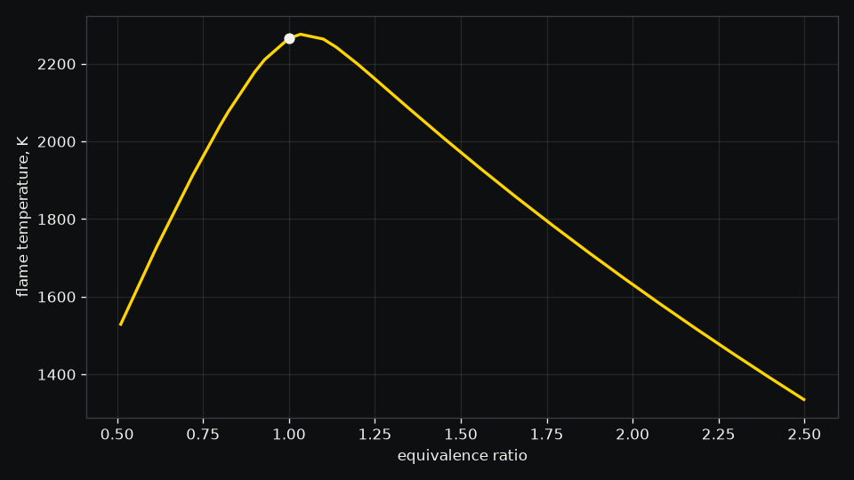

# Propane flame

How hot does a propane flame in air get, and how much CO and NO does it make?

This is propane mixed with exactly the air it needs, an equivalence ratio of 1, at 1 atm and 25 C,
as in a torch or a premixed burner. Wobbl burns it to chemical equilibrium on NASA's thermodynamic
data with Cantera.

```sh
./run.sh
```

| Result | Value |
|---|---|
| Adiabatic flame temperature | 2266 K (1992 C) |
| Without dissociation | 2392 K, so breaking CO2 and H2O apart at the flame takes 126 K off |
| GRI-Mech 3.0's own data | 2266 K, 0.07 K from NASA's |
| Equilibrium CO and NO at the flame | 1.25% and 0.234% |
| Flammability | 4.03% propane, inside the 2.1% to 9.5% it burns over in air |



The flame is hottest just rich of stoichiometric, near an equivalence ratio of 1.05, and cools
steeply on either side, which is why a burner runs lean to keep its walls and its NO down. The
temperature is an upper bound for a real flame, which loses heat by radiation and to the burner, and
the equilibrium NO is more than a flame makes in the few milliseconds the gas spends in it. For a
flame that has to stay under a temperature, `wobbl flame propane --limit "1800 C"` finds the leaner
mixture that meets it.
