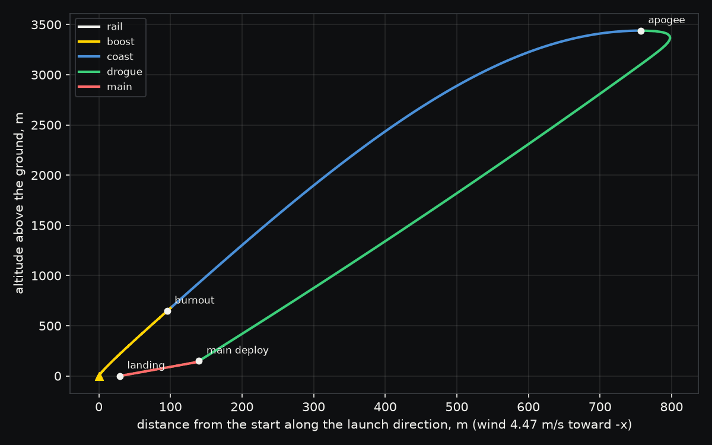

# Rocket launch

Will an L class rocket fly straight, reach 11,000 ft and land softly in a 10 mph wind?

This is a level 2 high power rocket, a 98 mm fiberglass airframe 2.1 m long with an ogive nose and
three clipped delta fins, flying on a 75 mm L class motor of 3773 N s that burns for 2.65 s. It
weighs 7.95 kg on the pad and leaves an 8 ft rail tilted 5 degrees into a 10 mph wind. An altimeter
fires an 18 inch drogue at apogee and a 60 inch main at 150 m on the way down. Everything is in
[`rocket.toml`](rocket.toml), with a comment on every line.

```sh
./run.sh
```

| Result | Value |
|---|---|
| Apogee | 3439 m (11284 ft) at 23.5 s, 2.6% over the 11,000 ft target |
| Top speed | 427 m/s, Mach 1.27, just before burnout at 2.65 s |
| Stability | 1.88 calibers off the rail by Barrowman's method, rising to 3.38 as the propellant burns |
| Off the rail | 30.6 m/s, twice the 15 m/s the fins need to steer |
| Peak loads | 106 kPa of dynamic pressure at top speed and 20.8 g on the thrust peak |
| Descent | 19.9 m/s under the drogue, then 5.72 m/s under both parachutes |
| Landing | 29.3 m upwind of the pad, 203 s after ignition |


The rocket passes Mach 1 at 1.76 s. Through the transonic range its drag coefficient climbs from 0.45
to 0.77, and by burnout drag has taken 96.9 m/s of the 541 m/s the motor could give it. Off the rail
it turns into the wind it feels, so it climbs upwind and is 757 m from the pad at apogee, and the wind
carries it back during the three minute descent until it lands near where it started.



Wobbl checks itself on the way. Tsiolkovsky's ideal delta v less what gravity, drag and steering took
matches the speed at burnout, the work done by thrust, drag and gravity matches the change in kinetic
energy, the sink rate under each parachute matches its terminal speed, and every number held when the
flight was integrated again with a tolerance ten times tighter. The model is a point mass in a vertical
plane that turns into the relative wind at its weathercock frequency, which is the usual depth for
planning a flight but not a six degree of freedom simulation, and Barrowman's method is subsonic, so
the margin past Mach 1 needs a supersonic method. At 106 kPa it is also worth checking the fins for
flutter.

The full flight is in `output/trajectory.csv`, at most 500 rows with one at every event, each with
time, downrange distance, altitude, speed, acceleration, mass, Mach number, dynamic pressure and phase.
