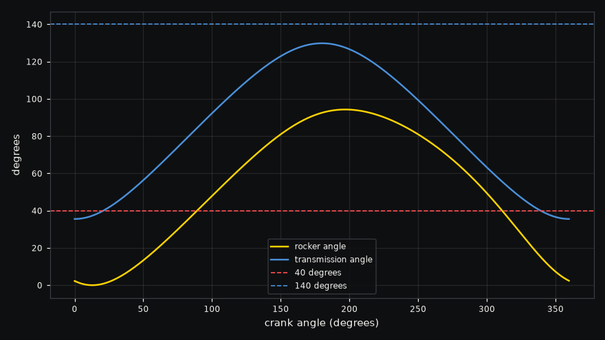

# Wiper linkage

Does this wiper linkage sweep 95 degrees, and can a 45 rpm wiper motor drive it over dry glass?

A windshield wiper turns a motor's full rotation into a back and forth swing with a four bar linkage.
Here the motor's crank is 80 mm long, a 300 mm coupler carries its motion across to a 110 mm rocker on
the wiper's pivot, and the two pivots sit 300 mm apart. The motor after its worm gear stalls at 25 N m
and turns 45 rpm with no load. Dry glass is the hard case, so the blade's drag is taken as 6 N m against
the wiper's motion at its pivot.

```sh
./run.sh
```

| Result | Value |
|---|---|
| Sweep | 94.3 degrees, from 50.1 to 144 degrees, within 1 degree of the 95 wanted |
| Transmission angle | between 35.5 and 130 degrees, below the usual 40 degree floor near one end of the swing |
| Motor | turns the crank at 39 rpm on average, peaks at 5.41 N m and averages 3.60 N m RMS, well inside its 25 N m stall |
| Hand calculation | Freudenstein's equation puts the rocker within 0.0007 degrees of MuJoCo's at every crank angle |
| Virtual work | the torque at the crank matches the load times rocker speed over crank speed to 0.24% |
| Fix | a crank of 82 mm, a coupler of 290 mm and a rocker of 112 mm keep a 94.3 degree sweep with the transmission angle between 40.8 and 139 degrees, and running it again the crank peaks at 5.18 N m |



The motor has plenty in hand, so the verdict is marginal for the geometry rather than the drive. Where the
crank and coupler fold back on each other the coupler pushes on the rocker at only 35.5 degrees, so most
of its force goes into the pivot pins instead of turning the wiper, which wears the pins and makes the
linkage stiff to drive there. Wobbl works out the swing and the transmission angle at the two toggle
positions, where crank and coupler line up, for thousands of crank, coupler and rocker lengths, picks the
set that keeps the sweep and holds the angle closest to 90 degrees, and then runs that linkage again with
the same motor and load.

The linkage is simulated twice. A slow turn of the crank against a steady load gives the geometry and
the torque that virtual work predicts, and a run at full speed with the real motor gives the speeds and
the torque it draws. The full speed run closes its energy account, with the motor's work going into the
blade's drag and the links' motion, and gives the same peak torque at half the time step. The links are
rigid and the pins have no friction or play.

The motion of every joint is in `output/trajectory.csv`, with the crank, coupler and rocker angles,
speeds and torques. `output/playback.json` holds the links as simple shapes with their poses through the
run, with the crank torque and the motor's limit beside them, so the swing can be played back as it was
simulated.
